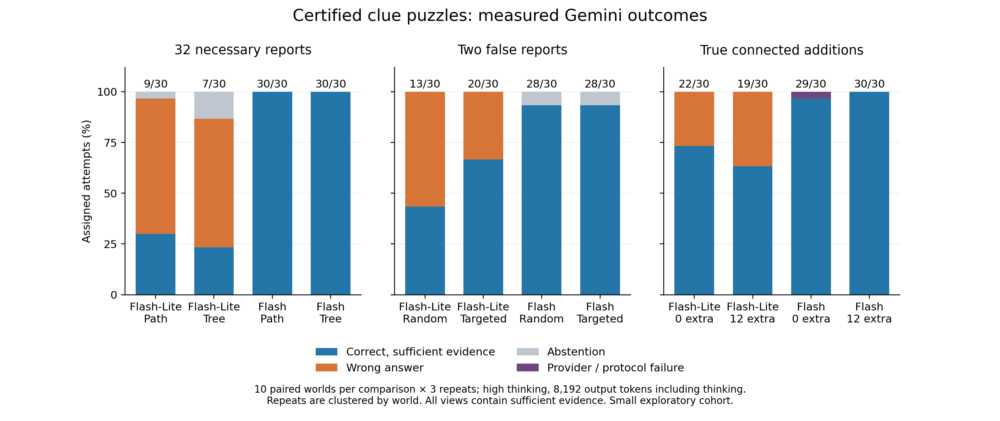

# Measured hardness demonstrations — 2026-10-10–11

**The generator supplies solvable cases that separate necessary evidence,
unreliable reports and useful extra comparisons.** This small study found frequent
Flash-Lite failures and occasional Flash abstentions with sufficient evidence.
Targeted corruption did not make the stronger model perform worse than random
corruption. Adjustable controls are useful for experiments; they are not a
promise that every increase makes every model fail.

## Study and accounting

- Models: `gemini-3.5-flash-lite` and `gemini-3.8-flash`, **high thinking**,
  temperature zero, **8,192 output tokens including thinking**.
- Six arms, ten paired worlds per comparison, three repetitions per model:
  **360 assigned requests across 30 underlying worlds and 60 puzzle variants**.
  Repetitions and variants do not supply independent worlds.
- Complete information, deterministic **text-only reports**, public rules/domains
  and a display-name map. Native `answer(target)` and `abstain()` tools; no solver
  or external tools supplied to models. Evaluator labels and certificates stay private.
- **359 settled responses, one retained provider timeout**;
  all 360 original assignments were dispatched. The original
  600-second timeout produced no usable response or usage receipt. A freshly
  approved continuation sent only the 88 untouched assignments; it never retried
  the failed request. Original and continuation receipts remain separate.
- Frozen-rate usage estimate: **$9.682723 settled + $0.039618 held**,
  below the $15 study ceiling. Combined accounting with the earlier pilot is
  **$13.903345**, within
  the original $20 ceiling. This is accounting at frozen token prices, not an invoice.
- All planned contexts fit. The largest observed input was **17,977
  tokens**, below the declared **1,048,576-token** context capacity. This study
  tests reasoning and reliability at modest context sizes. The earlier
  [archive-volume pilot](pilot-results.md) separately measured inputs up to 230,884 tokens.

## Thirty-two necessary reports: a calibrated burden control

Path and branching-tree arms share worlds, exact necessary-report count, six
truthful additions on non-target attributes, and 100 independent records:
**138 total records, exactly 32 needed** under the published logical rules.

- Flash-Lite: **9/30 path**, **7/30 tree**.
- Flash: **30/30 in each arm**.
- Flash-Lite's path/tree difference is small relative to the descriptive paired
  world interval. This study does not establish a structural-shape effect.
- Single-attribute scaffolds may admit construction-specific heuristics.
  Certified evidence cost is not a guarantee that a model followed a 32-step
  proof or had to process every record.

## Two false reports: failures to recover an available answer

Each eight-suspect, seven-attribute case has **63 reports**, exactly two factual
corruptions and the public assumption **at most two reports are false**. Actual
corruption counts and false identities are hidden. All visible views have a
certified unique culprit. In the sampled worlds, wrong suspects share two crime attributes; a single
attribute does not identify the answer.

- Random corruption: Flash-Lite **13/30**;
  Flash **28/30**, with two abstentions.
- Targeted corruption: Flash-Lite **20/30**;
  Flash **28/30**, with two abstentions.
- Flash gave **no incorrect valid answers** in these arms. Its four misses were
  abstentions despite sufficient information, distinct from appropriate abstention
  on an ambiguous private view in the earlier distributed experiment.
- Targeted cases retain a verified wrong explanation exactly one violation
  outside the allowed region. This logical margin did not translate into worse
  Flash performance in this cohort; Flash-Lite performed better on targeted cases.
- This study compares two corruption-selection policies. It has no uncorrupted
  63-report model baseline, so it does not isolate the effect of adding false reports.

## Connected truthful additions

The paired near-solution cases have five attributes and **45 versus 57 reports**.
They contain zero actual false reports but retain the published allowance of two.
The closest wrong explanation needs three violations in both conditions.
Twelve extra comparisons are true and core-entailed, involving the same suspects
and attributes; they are not independent nuisance records. Cost bounds are
recertified, and useful additions can shorten a solution.

- Flash-Lite: **22/30 without additions**,
  **19/30 with twelve additions**.
- Flash: **29/30 assigned without additions**,
  including 1 retained provider failure; settled success
  was **29/29**. With twelve additions:
  **30/30 assigned**,
  **30/30 settled**.
- Preserve the provider failure in assigned-denominator comparisons. It is not
  an observed reasoning error. The small paired comparison is descriptive;
  extra true comparisons need not be harder than the original core.



## Inspect actual failures and reproduce the inputs

[Four small development examples](../examples/datasets/measured-failures/README.md)
include exact public observations and separate private labels/certificates.
They were selected after measurement and must not be treated as held-out estimates.
The random-corruption example made Flash abstain twice out of three attempts;
the path/tree example made Flash-Lite answer incorrectly on all three attempts.
Future repetitions may differ.

[Aggregate results](../benchmarks/hardness-results.json) preserve model settings,
world-clustered metrics, split-specific counts, descriptive paired-world bootstrap
contrasts, token counters, latency, output-cap indicators and source receipt hashes.
[Per-assignment outcomes](../benchmarks/hardness-episodes.jsonl) retain all 360 slots,
including the timeout. Latency is measured request/normalization time and excludes
pacing and grading. Supported correctness establishes that the visible evidence
identifies the answer; it does not verify a reasoning trace.

The [reproduction index](../benchmarks/hardness-reproduction.json) hashes a
[compressed snapshot](../benchmarks/data/hardness-2026-10-11.tar.gz) containing the
full 19-arm certified bank, six frozen original plans, saved original receipts,
and the continuation inputs/plans/receipts with an explicit assignment map.
Only the six selected arms were evaluated. The full bank has 190 variants over
50 worlds. **This archive contains evaluator data; never supply the whole archive
to a model.** Credentials, authorizations, ledgers and checkpoints are excluded.

```sh
mkdir -p runs/hardness-reproduction
tar -xzf benchmarks/data/hardness-2026-10-11.tar.gz -C runs/hardness-reproduction
python examples/collect_hardness_results.py \
  --datasets runs/hardness-reproduction/datasets \
  --plans runs/hardness-reproduction/plans \
  --runs runs/hardness-reproduction/results \
  --continuation runs/hardness-reproduction/continuation-0 \
  --measured-date 2026-10-11 \
  --output runs/reanalysed-hardness.json --episodes runs/reanalysed-hardness.jsonl
python -m pip install '.[figures]'
python examples/plot_hardness_results.py \
  --results runs/reanalysed-hardness.json --output runs/hardness-outcomes
```

Reanalysis makes no model calls and reads no credentials. The frozen package
source is version `0.5.0.dev2`, implementation commit `b993b75`; individual source
hashes are in every plan and exact source copies are in the snapshot. A future
source change requires using that frozen implementation for historical reanalysis.
Any new live evaluation requires new explicit authorization; archived plans are
not authorization.

## Interpretation limits

- Ten paired worlds per comparison are a small exploratory sample. Bootstrap
  intervals cluster repetitions by world, are descriptive, and have no multiplicity
  adjustment. All-equal results can produce degenerate intervals without proving
  population-wide perfection. Development/test counts are reported separately.
- The fixed output budget matters: **215 responses used at least 95% of the
  configured cap**, and **0 had `MAX_TOKENS` termination**. A `STOP` receipt
  does not prove the reasoning budget was nonlimiting. Wider-budget replication
  is needed before stronger capability claims.
- Model aliases were used. Returned model identities are preserved per request.
  Two reference models cannot establish a weakness across all frontier models.
- The older pilot used low thinking, 4,096 output tokens and structured reports;
  cross-study accuracy differences do not isolate puzzle complexity.
- The separately certified 32-suspect relational stress example has 231 reports;
  it was not evaluated here. Nor were the new archive-placement or eight-agent arms.
  No 50,000-necessary-clue or million-token capability claim is made.
- Public release still requires independent language review, independent
  reproduction and resolved licensing. The [resource comparison](resource-comparison.md)
  remains a dated research position, not a novelty proof.
