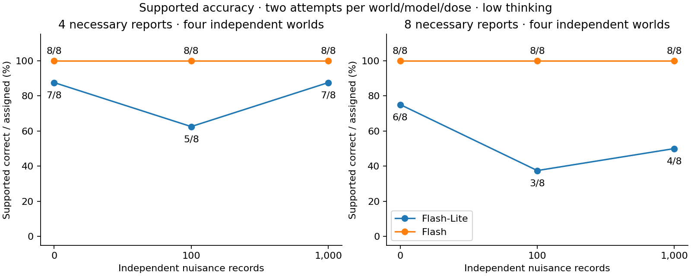
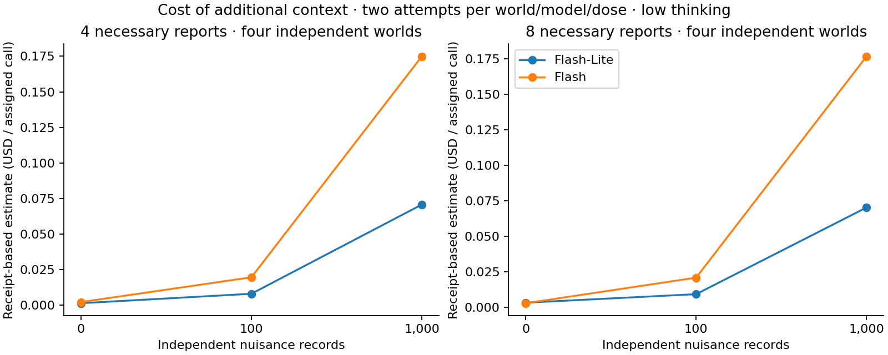

# Irrelevant-evidence follow-up — October 27, 2026

The prepared plan is fixed before outcomes ("frozen"), not suspended because of
a software failure. The user explicitly instructed paid execution in the chat
on October 27 after receiving the exact size and maximum cost. The instruction
and plan-bound authorization are retained privately in the ignored run directory;
neither is part of a distribution archive or committed source.

## Fixed protocol

- Study ID: nuisance-followup-20261027.
- Manifest: `1fd16445c52a4bed3d55b100d86c285c74b036340da65c1d505060621055ce42`.
- Eight fresh independent worlds: four with four necessary reports and four
  with eight. Branching construction; suspects equal necessary-report burden;
  clue_count equals suspects plus four. Structural screening covered 121 prior banks.
- Per world: 0, 100, 1000 satisfiable independent records; the first 100 form an
  identical prefix in the largest dose. Core facts, wording, relative order,
  world, answer, names, domains and certified bounds remain matched. Core first.
- Models: gemini-3.5-flash-lite and gemini-3.8-flash, low thinking, temperature
  zero, 4096 output tokens including thinking, structured_text, native answer/
  abstain actions, no external tools. Complete information; no false reports;
  public corruption allowance zero.
- Two separately dispatched attempts per model/dose/world: 96 scored calls.
  Two native compatibility probes precede scored calls. Exact returned identities
  and valid native actions/known usage are required before continuing.
- Total maximum: $9.338478 for scored calls plus a $0.50 probe allowance,
  **$9.838478 combined**, under one $10 cap. Historical budgets are not reused.
- Sequential calls, seed-0 randomized world/dose block order, durable fixed child
  ledgers, 600-second timeouts and zero automatic retries. Unknown usage,
  identity drift or resource breaches stop later jobs and retain reservations.

Primary endpoint: Lite's 1000-minus-zero supported accuracy in the four-report
stratum, averaging two attempts within each world. Secondary contrasts include
100-minus-zero, eight-report worlds, Flash and between-model differences.
Four independent worlds per stratum give coarse exact-test resolution and wide,
descriptive world-bootstrap intervals; attempts are not independent worlds.

## Interpretation and offline replay

The motivating five-world observation was Lite 2/5, 3/5, 5/5 as independent records
increased; Flash was 5/5 throughout. The eight-report stratum did not show the
same improvement and retained one provider failure. This follow-up does not
isolate a mechanism: context length and composition change together, and
recognizable independent records are not realistic adversarial prose.

After execution, the immutable raw run remains private. Its offline analysis
preserves all 96 scored assignments, separates never-dispatched slots from
observed failures, records two-attempt disagreements and changed-world actions,
and reports token/latency costs and small exact paired comparisons. It makes no
claims about unobserved internal reasoning. No additional paid conditions are
included, regardless of the direction of the result.

Using the exact frozen source and saved run, replay without provider calls:

```sh
python examples/analyse_nuisance_followup.py runs/nuisance-followup-20261027-rc1 --output runs/followup-replayed --figures
```

The output includes analysis.json, per-call.jsonl, panels.csv, changed-worlds.json,
a local HTML report, paired accuracy/cost figures and checksums. Replaying never
calls a provider; use a new output directory.

## Completed measured results

All 98 native calls completed: 96 scored assignments and two separately billed
compatibility probes. Eight underlying worlds, four per burden stratum; every
model/dose panel has eight assignments (two attempts per world). All actions
were protocol-valid; no provider/transport failures, identity drift or resource
breaches occurred. Twelve valid answers were wrong and four abstentions were
unnecessary on these certified complete views. All other 80 scored actions were
supported correct answers. No scored slot is omitted.

At 0/100/1000 nuisance records:

- Four-report Lite: **7/8, 5/8, 7/8**. Primary 1000-minus-zero effect: **0 percentage
  points**; one world gained 0.5 and another lost 0.5. Descriptive 95% world-cluster
  bootstrap interval **[-37.5, +37.5] points**, exact two-sided sign-flip p=1.0.
- Eight-report Lite: **6/8, 3/8, 4/8**. The 1000-minus-zero secondary effect was
  **-25 points**, with a descriptive interval [-75, +25] points, p=0.75.
- Flash: **8/8 at every dose in both strata**. No observed dose effect; a ceiling
  score in this small cohort does not establish immunity to context effects.

Lite's two attempts disagreed in **9/24 world-dose pairs**; Flash's disagreed in
0/24. All changed-world actions are indexed in the saved analysis; these are
observed actions, not recovered internal thoughts. With only four independent
worlds per stratum the exact comparison has coarse resolution (1/16 before
symmetry/ties), and these intervals are descriptive, not population guarantees.

The follow-up **did not reproduce the earlier aggregate Lite improvement**.
A null/negative result is retained without changing endpoints or adding paid
conditions. Recognizable independent records and joint context-length/composition
changes limit generalization and mechanism claims.

Estimated cost from recorded usage and dated prices: **$4.731671**, including
**$0.244634 for both probes**. No unresolved holds; this is not a provider invoice.
All child maximum ceilings still sum to $9.838478, below the single $10 cap.





[Machine-readable report](../benchmarks/nuisance-followup-results.json),
[per-assignment outcomes](../benchmarks/nuisance-followup-episodes.jsonl),
[changed-world actions](../benchmarks/nuisance-followup-changed-worlds.json), and
[source/checksum/sanitization index](../benchmarks/nuisance-followup-reproduction.json).
The indexed local reproduction archive excludes approvals, raw usage dictionaries,
ledgers and nonselected candidate worlds. Original operational records stay private.
Rights/privacy clearance remains pending before any public artifact distribution.
