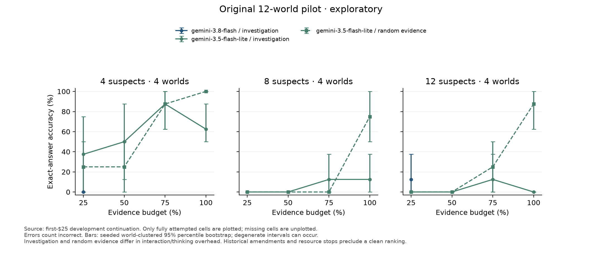
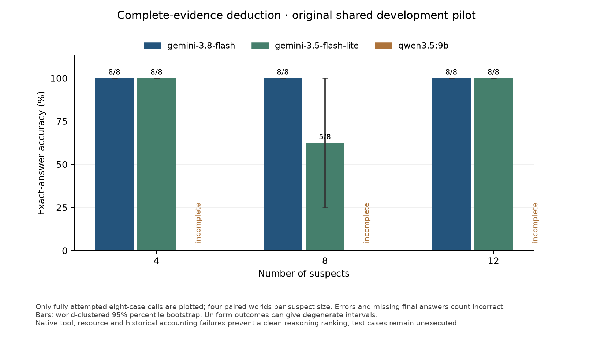

# First-$25 development continuation

Snapshot: **interim; model execution is still in progress**, generated 2026-10-04T02:24:02.156359+00:00. The frozen cumulative Gemini ceiling is **$25**, including the original pilot and all held requests. The other $25 has not been used.

Estimated returned-usage API charges: **$4.050970**. Held failed-request maxima: **$1.436797**. In-flight or uncertain reservations: $0.801792. Total committed allowance: **$6.289559**; remaining $18.710441. These use frozen standard token prices and are not invoice reconciliation. Local energy and hardware costs are excluded.

Frozen manifest: `d50fe24b4082a8b9d66dd0b90ac6f209a70134dee14d5c36cbb05a62f4e890aa`. Native request count: 1818. Declared rows: 4104. All 744 test cases remain unexecuted by models.

## Coverage and complete-evidence deduction

The initial cohort contains the original 12 paired worlds (24 cases), 216 rows per model. The expansion contains 96 additional paired worlds, 1,728 rows per Gemini model. Qwen/Gemini comparisons use the initial shared cohort only. The larger expansion excludes the diagnostic worlds.

### Initial pilot

- **google/gemini-3.8-flash**: 169/216 finished; 128 completed submissions; 65/216 correct in the declared denominator. Complete-evidence deduction: 24/24 correct, 24 finished. Finished-row errors: {'none': 129, 'token_limit': 34, 'protocol_incompatible': 2, 'provider_error': 2, 'timeout': 1, 'missing_usage': 1}. Evidence diagnostics: 58/169 identifying; 0 submitted answers inconsistent with revealed evidence.
- **google/gemini-3.5-flash-lite**: 216/216 finished; 183 completed submissions; 77/216 correct in the declared denominator. Complete-evidence deduction: 21/24 correct, 24 finished. Finished-row errors: {'none': 183, 'provider_error': 1, 'token_limit': 31, 'timeout': 1}. Evidence diagnostics: 61/216 identifying; 11 submitted answers inconsistent with revealed evidence.
- **ollama/qwen3.5:9b**: 88/216 finished; 54 completed submissions; 21/216 correct in the declared denominator. Complete-evidence deduction: 3/24 correct, 10 finished. Finished-row errors: {'none': 73, 'token_limit': 15}. Evidence diagnostics: 25/88 identifying; 12 submitted answers inconsistent with revealed evidence.

Fully attempted world schedules shared by all models in this cohort: **4**. Paired gaps and world-clustered 95% intervals are in analysis-summary.json. This additional comparison is post-hoc; scored failures remain incorrect and no worlds are filtered by answer success.

### Expanded development

- **google/gemini-3.8-flash**: 0/1728 finished; 0 completed submissions; 0/1728 correct in the declared denominator. Complete-evidence deduction: 0/192 correct, 0 finished. Finished-row errors: {}. Evidence diagnostics: 0/0 identifying; 0 submitted answers inconsistent with revealed evidence.
- **google/gemini-3.5-flash-lite**: 0/1728 finished; 0 completed submissions; 0/1728 correct in the declared denominator. Complete-evidence deduction: 0/192 correct, 0 finished. Finished-row errors: {}. Evidence diagnostics: 0/0 identifying; 0 submitted answers inconsistent with revealed evidence.

Fully attempted world schedules shared by all models in this cohort: **0**. Paired gaps and world-clustered 95% intervals are in analysis-summary.json. This additional comparison is post-hoc; scored failures remain incorrect and no worlds are filtered by answer success.

## Budget curves and interpretation





The figures plot only fully attempted cells. Missing cells are explicitly unplotted. Failed attempts count incorrect. Expansion figures, when available, use whole world schedules attempted by both Gemini models. Primary declared-denominator accuracy, evidence-budget averages, mean clues/requests, invalid actions, completion, tokens, costs, latency, and paired strategy/model gaps remain in results.json. All related variants and conditions remain in their world cluster for uncertainty estimates. Uniform outcomes can give degenerate intervals; these do not imply perfect population accuracy.

Investigation makes successive native tool calls, while random controls receive their selected clues before answering. Their contrast includes conversation and thinking overhead and cannot isolate topic-selection quality. Cumulative 32,768 input-plus-output tokens count repeated conversation history, and the 4,096 per-call output maximum includes thinking. Report resource and submission failures alongside accuracy; this run does not establish a clean model ranking.

## Evidence and representative failures

Evidence diagnostics reconstruct exactly the successful clue reveals in each native transcript and use structured versions of those clues to enumerate feasible murderer candidates. No private world attributes or unrevealed clues are used for inference. These diagnostics are evaluator-only and post-hoc. Unresolved solver results remain unknown. A wrong feasible suspect with several remaining candidates differs from an answer excluded by the revealed evidence. Conditional accuracy after identifying evidence is descriptive and subject to selection.

manual-review.json retains the six original examples and four continuation examples. Reviewed Qwen submissions in four- and eight-suspect cases directly contradict a crime_different_from clue naming the submitted suspect. Another twelve-suspect complete-evidence episode ended with 4,096 generated tokens, empty content, no final tool call and no answer. Internal thinking is not available; these examples establish observable output failures, not the model's cognitive process. They are selected Codex reviews, not independent human annotations or a prevalence estimate.

## Accounting and execution amendments

The continuation copied all 82 historical episodes and 213 requests into an audited durable ledger. Original request 213 is user-reported HTTP 503; its full $0.324813 maximum remains held. Native 503 failures retain their maximum reservations and failed scores, with no automatic retry. The user subsequently authorized retaining full maximum charges for failed timeouts, then explicitly approved applying the same maximum-charge holds to unverifiable successful-response usage. These remain failed scored episodes with unknown actual usage and charges, never zero-cost assumptions. Other unclassified unresolved errors and native incompatibilities still stop execution. Paid and free local execution have independent locks; all paid requests remain sequential.

The revised preflight adds 12.5% plus 1,024-token headroom, and bounds native thinking history using prior reported usage. Each new request records the input bound, output cap, and remaining cumulative allowance. Actual reported violations still stop the model. Historical cap violations and SDK failures remain scored and preserved. accounting-recovery.json records each held timeout and restored model. The current frozen controller identity is in studies/pilot-v0.3-reserved-recovery.json; no failed episode or request is replayed. Qwen was already running with the preceding manifest and unchanged native source/settings; aggregate exports bind all preserved rows to the current plan, with each row retaining its execution source identity.

Observed new request allowance violations in this export: **0**. Outstanding accounting holds and runtime model states remain visible in cost-ledger.json. Original source snapshots, manifest amendments and results are preserved.

## What to change before the second $25

1. Match the answer-stage evidence context and generation allowance across agent and random selections. A two-stage design can select clues first, then answer from a fresh standardized context. Retain an end-to-end resource-bounded secondary metric and charge every stage.
2. Balance or permute suspect labels consistently across paired variants, with frozen mappings and equal label representation. In the current expanded four-suspect cohort, S02 is correct in 17/32 worlds, so a constant S02 guess scores 53.125%.
3. Separate requested evidence from evidence actually acquired, identifying evidence, contradictory answers, missing final calls, and per-call/cumulative resource stops. Select a clear token estimand and check native thinking/output limits before freezing it.
4. Improve and independently review the controlled-English clue grammar, especially 'different ... value as suspect'. Version presentation changes without altering existing generated worlds. Add a small human solvability/interpretation check before test execution.
5. Use balanced independent worlds, then allocate repeats to estimate sampling variance. Validate genuinely necessary cross-attribute reasoning rather than assuming the category label guarantees it. Freeze the next study only after reviewing this phase; the second $25 remains reserved.

The detailed unexecuted proposal is in next-study-proposal.md. It does not change this phase's prompts, data, native tools or sampling settings.

## Larger-study planning

- **google/gemini-3.5-flash-lite**: 214 usage-complete measured episodes; naive projection $134.97 for 20,088 test episodes (744 cases × nine conditions × three repeats); measured-time projection 89.1 sequential hours.
- **google/gemini-3.8-flash**: 168 usage-complete measured episodes; naive projection $308.63 for 20,088 test episodes (744 cases × nine conditions × three repeats); measured-time projection 103.3 sequential hours.
- **ollama/qwen3.5:9b**: 88 usage-complete measured episodes; naive projection $0.00 for 20,088 test episodes (744 cases × nine conditions × three repeats); measured-time projection 496.0 sequential hours.

These extrapolations are biased by development selection, incomplete condition coverage, resource failures, historical revisions and changing prices. Per-world mean episode cost intervals are in results.json. Conservative API-only all-output bounds at 32,768 reported tokens are $2,468.41 for Flash and $1,645.61 for Flash-Lite for the reference full study; probes and historical violations are additional. No full study is executed or authorized here.

Qwen uses Apple M4 Pro, 24 GiB physical memory, Ollama 0.34.0, Q4_K_M digest `6488c96fa5faab64bb65cbd30d4289e20e6130ef535a93ef9a49f42eda893ea7`, and 32,768 configured context tokens. Its native compatibility probe passed and verified the loaded context and digest; loaded VRAM was approximately 6.11 GiB. Thinking is included in eval_count with no separate component. Hosted/local latency is descriptive, not a capability ranking.

## Reproduction and verification

The authoritative resume state is the local ledger.sqlite3; do not delete it or re-prepare a fresh budget. JSON, logs, checksum lists and figures are review artifacts. Export, evidence diagnostics and reporting make zero generation calls. The continuation source passed 151 tests, release/provenance checks over all 960 cases, package build and installed-wheel smoke verification. Additional post-hoc diagnostics checks are recorded in verification.json when present. Repository privacy and credential-pattern scanning are checked before final publication to the private Git branch. Licensing/publication and model selection remain pending.

```sh
uv run --locked python scripts/export_native_run.py studies/pilot-v0.3-reserved-recovery.json
uv run --locked python scripts/evidence_diagnostics.py studies/pilot-v0.3-reserved-recovery.json
uv run --locked python scripts/report_continuation.py studies/pilot-v0.3-reserved-recovery.json --final
```

Scientific figures use scripts/plot_continuation.py with a separate matplotlib runtime; no plotting dependency changes the frozen runner. See docs/pilot-continuation.md for native execution and budget controls.
