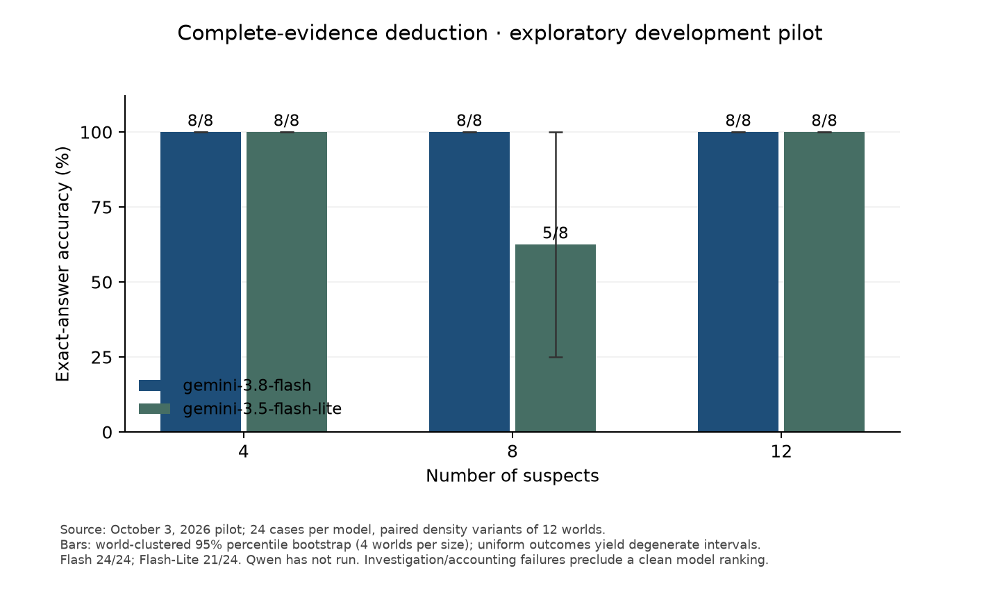
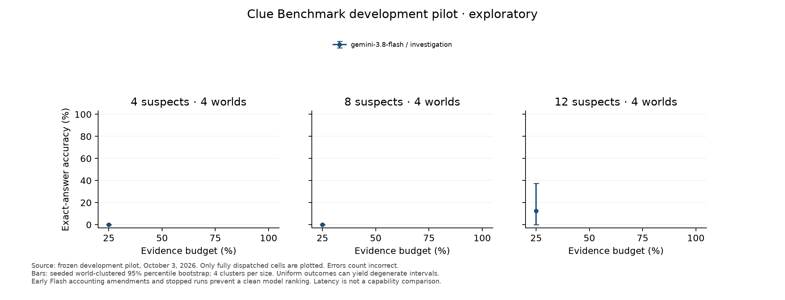

# Exploratory three-model pilot results

Run status: **incomplete**. 82 of 648 declared scored episodes were dispatched; 566 were not run. The test split’s 744 cases received no live model execution. All failed/missing episodes remain incorrect in the declared denominator, and dispatch coverage is reported separately.

Estimated standard API charges: **$1.052975** across both Google models, including compatibility probes. Unresolved reservations: $0.324813; total committed allowance: $1.377788 of $50. These are calculations from returned usage and frozen standard prices, not an invoice reconciliation.

## Coverage and complete-evidence deduction

- **google/gemini-3.8-flash**: 56/216 dispatched; runtime state `accounting_stopped`. Complete-evidence deduction: 24/24 in the declared denominator (24 dispatched). Missing/failed answers and costs are detailed in results.json.
- **google/gemini-3.5-flash-lite**: 26/216 dispatched; runtime state `accounting_stopped`. Complete-evidence deduction: 21/24 in the declared denominator (24 dispatched). Missing/failed answers and costs are detailed in results.json.
- **ollama/qwen3.5:9b**: 0/216 dispatched; runtime state `not_started`. Complete-evidence deduction: 0/24 in the declared denominator (0 dispatched). Missing/failed answers and costs are detailed in results.json.

## Evidence budgets and uncertainty





The machine-readable summary reports exact accuracy by suspect size and each of 25%, 50%, 75%, and 100% evidence, mean clues/requests, invalid actions, completion, tokens, costs, and measured latency. Paired strategy and model differences use seeded world-clustered 95% percentile bootstrap intervals. Each size has only four independent worlds; variants and repeated conditions remain in their world cluster. Missing observations are not silently dropped. Intervals can collapse for uniform outcomes and do not establish perfect population accuracy.

The accuracy figure shows only fully dispatched investigation cells. Incomplete cells and models remain explicitly missing in the report; the figure does not portray their unexecuted episodes as measured accuracy. The fixed random-topic schedule supplies clues before answering, so its comparison with investigation also includes tool and conversation overhead. It is not a pure causal measure of topic-choice quality.

## Execution amendments and protocol failures

Three source amendments retained every prior episode ID, score, request, cost, and source identity. They corrected the byte-bound treatment of thinking history, the Developer API countTokens schema, and preflight undercounting of billable native conversation history. Six early Flash episodes stopped on the original guard, two episodes retain maintenance/SDK preflight failures, and an earlier episode accumulated 38,361 tokens against the intended 32,768 allowance. None were replayed or excluded.

The paid run then stopped on a Flash-Lite provider error without returned usage. The missing charge remains reserved and paid execution is blocked; no request was retried or treated as free. The explicit missing-usage stop was applied to all model execution, so Qwen remains unexecuted. No further generation calls were made.

Flash previously stopped on another allowance violation: 32,826 tokens, 58 above the declared cap. The response was fully cost-accounted. That model remains stopped and its missing episodes remain in all primary denominators. Native accounting/protocol failures must not be interpreted as pure reasoning errors. The accounting limits and mixed source revisions prevent a clean model ranking. The full amendment chain and pre-amendment snapshots are retained with the manifests and ledger exports.

Observed error labels among dispatched rows: {None: 69, 'token_limit': 8, 'provider_error': 3, 'protocol_incompatible': 2}. Separate missing submissions, invalid answers, and completion rates are in the summary.

## Representative manual failure review

I inspected final-revision Flash wrong answers at 25% evidence for one case at each size, then checked symbolic feasibility using only the clues revealed in each transcript. The four-suspect case left three candidates, the eight-suspect case left six, and the twelve-suspect case left ten. All three submitted answers were feasible but wrong. The final-call transcripts provided no rationale, so guessing cannot be distinguished from an unsupported uniqueness assumption. These three partial-evidence examples show insufficient observed evidence, not demonstrated violations of the deduction rules. I also inspected three Flash-Lite complete-evidence errors. Each submitted suspect was explicitly excluded by a crime_different_from clue about that same suspect; the answer contradicts the supplied rule equating crime attributes with the murderer attributes. This is an observable output contradiction, while the model’s internal reasoning remains unobserved. The selected transcripts, clue texts, and feasibility checks are saved in manual-review.json; they are representative examples, not a prevalence estimate.

## Larger-study cost and runtime

- **google/gemini-3.5-flash-lite**: 25 episodes with reported usage; naive standard API projection $133.62 for 20,088 test episodes (744 cases × nine conditions × three repeats).
- **google/gemini-3.8-flash**: 56 episodes with reported usage; naive standard API projection $317.17 for 20,088 test episodes (744 cases × nine conditions × three repeats).
- **ollama/qwen3.5:9b**: 0 episodes with reported usage; naive standard API projection unavailable for 20,088 test episodes (744 cases × nine conditions × three repeats).

These projections are exploratory and can be biased by incomplete conditions, accounting stops, development selection, and changed prices. Treat incomplete-model projections as planning diagnostics, not funding commitments. Per-world mean episode cost intervals are included in results.json. If the 32,768 reported-token allowance were obeyed in every episode, an all-output allocation gives conservative API-only bounds of $2,468.41 for Flash and $1,645.61 for Flash-Lite, $4,114.02 combined for the reference full study; compatibility probes and violations are additional. No full-study execution is authorized or performed here.

- google/gemini-3.8-flash: mean measured episode wall time 20.01 s; a naive sequential 20,088-episode extrapolation is 111.6 hours. Incomplete conditions and protocol stops bias this estimate.
- google/gemini-3.5-flash-lite: mean measured episode wall time 10.83 s; a naive sequential 20,088-episode extrapolation is 60.4 hours. Incomplete conditions and protocol stops bias this estimate.

The local runtime is Apple M4 Pro with 24 GiB physical memory, Ollama 0.34.0, Qwen3.5-9B Q4_K_M, digest `6488c96fa5faab64bb65cbd30d4289e20e6130ef535a93ef9a49f42eda893ea7`, and 32,768 configured context tokens. Pinned runtime metadata is in studies/qwen3.5-9b-runtime.json; a native local generation and loaded-memory check was not reached. Hosted versus local latency is descriptive and is not a capability ranking; local electricity/hardware costs are excluded from API costs.

## Verification and reproduction

143 automated tests passed, together with lint/format checks, package build, installed-wheel smoke checks, 960-case dataset integrity, and original-generator provenance checks. A credential-pattern scan found no key in the deliverables. Repository visibility remained private; licensing and publication remain pending.

A restart check with a provider factory that forbids construction confirmed the accounting stop, unchanged 213 requests and 82 dispatched episodes, no new provider calls, and unchanged committed allowance. Use the frozen manifest directly for verification or safe resume; execution stays blocked while request 213 has unresolved usage. Preparation and dry runs have no generation calls; the runner keeps completed/stopped episodes and compatibility states in the durable SQLite ledger. Do not discard that ledger or re-prepare an executed plan to reset spending.

```sh
uv run --locked clue-benchmark study-check studies/pilot-v0.3.json
uv run --locked clue-benchmark run-study studies/pilot-v0.3.json --dry-run
# Only with GOOGLE_API_KEY supplied securely and explicit execution intent:
uv run --locked clue-benchmark run-study studies/pilot-v0.3.json
```

This pilot does not yet establish a reasoning ranking or that evidence selection improves accuracy. A confirmatory study needs a new, frozen protocol after accounting and native runtime issues are resolved; its test examples must remain untouched until that freeze.
