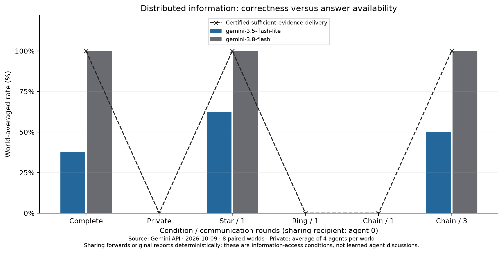
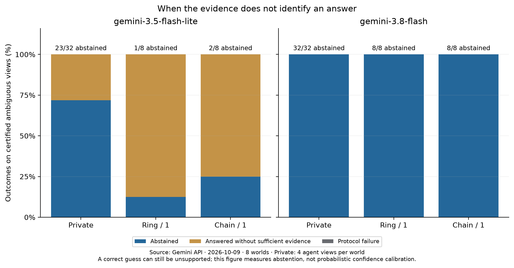
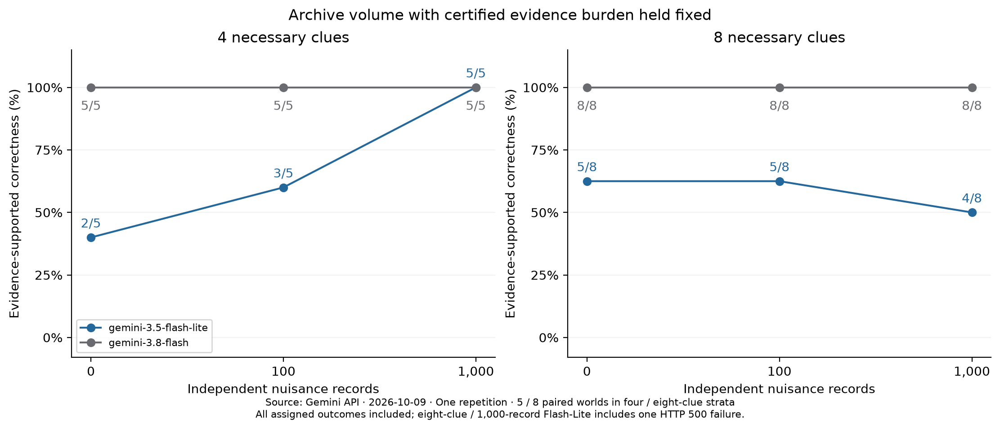
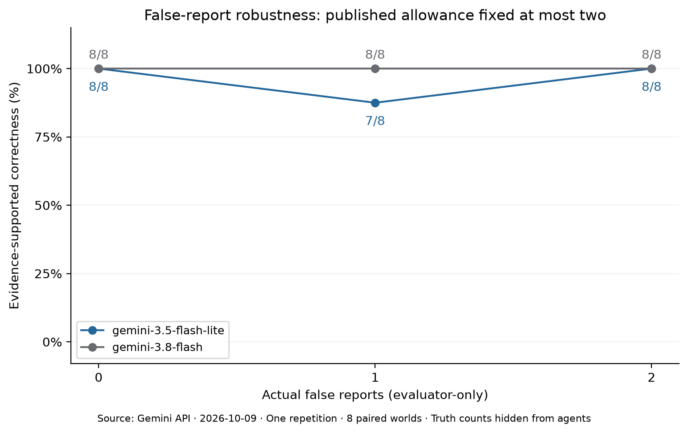

# Measured Gemini demonstrations — 2026-10-09

**The resource distinguishes unavailable evidence from failures to use available
evidence.** Three small demonstrations now have model measurements: archive
volume, factual false reports, and distributed information.

- Panel: `gemini-3.5-flash-lite` and `gemini-3.8-flash`, low thinking,
  temperature zero, 4,096-token output cap.
- Coverage: **270 assigned requests, 269 settled responses, one retained HTTP 500
  failure**. The approved 193-request continuation finished without new errors.
- Sampling: 21 underlying worlds; five matched worlds in four-clue archive arms,
  eight elsewhere. One repetition per assigned condition. Variants and agent
  calls are not independent samples.
- Inputs: deterministic text plus structured constraints, with native answer and
  abstention tools. These measurements do not isolate language comprehension.

## Distributed information: the strongest usefulness example

The same eight puzzles have twelve reports, four agents and a certified minimum
sufficient coalition of four. Every private view is ambiguous.

- **Complete evidence:** Flash solved **8/8**; Flash-Lite solved **3/8**.
- **Private evidence:** Flash abstained on **32/32** agent views; Flash-Lite
  abstained on **23/32** and gave nine unsupported, incorrect answers.
- **Star, one round:** all evidence reaches agent 0. Flash solved **8/8**;
  Flash-Lite solved **5/8**, with one abstention.
- **Ring, one round:** nine reports reach agent 0, but the answer remains
  ambiguous. Flash abstained on **8/8**. Flash-Lite abstained once and answered
  seven times, including **two correct guesses with no sufficient evidence**.
- **Chain, one round:** six reports reach agent 0; the answer remains ambiguous.
  Flash abstained on **8/8**. Flash-Lite abstained twice and guessed incorrectly
  six times.
- **Chain, three rounds:** sufficient evidence arrives. Flash solved **8/8**;
  Flash-Lite solved **4/8**, with one abstention.

This demonstrates why raw accuracy is insufficient: a correct guess can be
unsupported, while abstention can be appropriate. Nine reports can also be
insufficient despite an eight-report sufficient subset existing. Which reports
arrive matters as well as their number. Forwarding is deterministic code, not
learned agent conversation; these results do not establish a general topology
ranking.

## Archive volume: cost and clutter separated from necessary evidence

Within each stratum, zero, 100 and 1,000 independent nuisance records are added
to the same world and exact target reports. Certified minimum evidence stays
fixed at four or eight reports.

- **Four necessary reports:** Flash-Lite achieved **2/5, 3/5, 5/5**;
  Flash achieved **5/5** in each condition.
- **Eight necessary reports:** Flash-Lite achieved **5/8, 5/8, 4/8**;
  Flash achieved **8/8** in each condition.
- The last Flash-Lite score includes the retained provider failure: **4/7 settled
  successes plus one HTTP 500**, not four observed reasoning mistakes.
- The largest observed input was **230,884 tokens**, within the declared context
  capacity. No settled call overflowed context or violated the answer protocol.
- Adding volume did not consistently reduce accuracy. In the four-report stratum,
  mean receipt-based cost rose from about **$0.00088 to $0.07121** for Flash-Lite
  and **$0.00223 to $0.17412** for Flash between zero and 1,000 nuisance records.

These are recognizable independent records, not realistic adversarial prose or
1,000 necessary clues. Comparing four versus eight necessary reports also changes
suspect count; it does not isolate reasoning depth. The separate 50,000-record
profile is a scaling check, with no model calls.

## False reports: a robustness control at this size

All three conditions publish **at most two false reports**; agents see neither
the actual corruption count nor the corrupted identities. Each matched world
has the same original thirty-report core and a certified unique answer.

- Zero actual false reports: **8/8 for both models**.
- One false report: **7/8 for Flash-Lite, 8/8 for Flash**.
- Two false reports: **8/8 for both models**.
- There is no monotonic difficulty trend in this small cohort. This arm mainly
  supplies validated robustness controls; it does not establish a Flash weakness.
- Corruption can change minimum sufficient evidence. Verified subset-cost bounds
  are preserved; necessary-evidence cost is not held fixed in this comparison.

The independent reliability-aware solver recovers all 24 answers. A solver
assuming all reports true recovers 8/8, 6/8 and 4/8 in the respective conditions.
Those are diagnostic solver controls, separate from the model measurements.

## Reanalysis and limits

[Aggregate results](../benchmarks/pilot-results.json) include model settings,
accepted seeds/configurations, usage, cost, forwarding counts, source receipt
hashes and descriptive paired world-bootstrap contrasts.
[Per-assignment outcomes](../benchmarks/pilot-episodes.jsonl) are evaluator data;
do not provide them as agent inputs. PNG figures also have SVG counterparts.
The [experiment guide](pilot.md) and [small inspection bundles](../examples/datasets/pilot/README.md)
let researchers prepare their own demonstrations.

Some separately planned conditions deliver identical prompts: 270 assignments
contain **238 distinct serialized provider payloads**. Eight of 32 preplanned
identical-prompt pairs produced different answers, all for Flash-Lite. For
example, its clean archive with eight necessary reports scored 5/8, while the identical
complete-input baseline in the distributed demonstration scored 3/8. This is
observed output variation under frozen settings, not an information effect.
Forwarding can also change report order. Neither repeated prompts nor private
agent calls supply additional independent worlds.

Supported correctness certifies that the visible evidence identifies the answer;
it does not validate a reasoning trace. Small cohorts, one repetition and selected
synthetic families limit generalization. Bootstrap intervals are descriptive;
all-equal observed outcomes can give degenerate intervals. This is a resource
validation pilot, not a leaderboard, significance claim or broad frontier-model
weakness claim.

Estimated cost at frozen paid rates is **$4.006113**, with **$0.174891** retained in
unknown-usage reservations, against the original $20 ceiling. These are accounting
estimates, not a provider invoice. See the [execution checkpoint](pilot-checkpoint.md).
