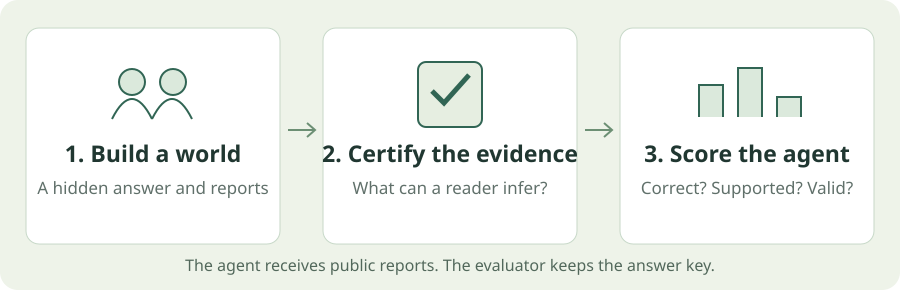

# What the guarantees mean

A certificate tells you what the evidence supports. It does not tell you how difficult a model will find the puzzle.
{.lead}

## The pipeline in three stages

### 1. Create and transform a case {#step-1-create-and-transform-a-case}

Validate the configuration, sample a seeded world, and build truthful core reports. Then apply the requested changes: irrelevant records, redundancy, false reports or presentation changes.

### 2. Certify what can be inferred {#step-2-certify-what-can-be-inferred}

Check the evidence under its public reliability rule. Create agent partitions, verify coalition conditions, and screen selected structural duplicates and splits.

### 3. Export and evaluate {#step-3-export-and-evaluate}

Render deterministic text and write a streamed bundle. Export only public agent views, then score returned actions against evaluator-only answers.

## What a score means

| Outcome | The question it answers |
|---|---|
| **Correct** | Did the agent name the actual responsible suspect? |
| **Supported** | Does the available evidence justify that answer? |
| **Sufficient evidence** | Could this view identify one responsible suspect? |
| **Valid protocol** | Did the agent return a permitted final action? |
| **Abstained** | Did it choose not to name a suspect? |

A correct guess on ambiguous evidence can be **unsupported**. Abstaining when several suspects remain possible can be appropriate; abstaining when one answer is established is unnecessary.

## Four different evidence states

- **Unique:** the evidence permits exactly one responsible suspect.
- **Ambiguous:** it permits several.
- **Inconsistent:** it permits none.
- **Unresolved:** the solver ran out of time or work before establishing the result.

Unresolved is never treated as a proof of uniqueness, inconsistency or unsatisfiability.

A private view can be ambiguous even when the complete view is unique. Globally ambiguous data remains ambiguous even with all reports.

## One culprit does not mean one complete world

Suspects can share motives, rooms, weapons or times. The default `repeated` assignment mode permits this.

Finding one responsible suspect does not determine every unmentioned attribute. You might rule out Ada without learning which weapon she has.

The `distinct` mode instead forbids repeated values within an attribute. It needs enough active domain values for every suspect.

## What does “at most k false reports” mean?

A truthful clue describes the sampled world. A **report** is the statement the agent receives; a sampled corruption can make it false.

An allowance of **at most two** permits **zero, one or two** false reports. It does not assert that exactly two are false.

The evaluator keeps the actual corrupted identities and count private. Structural rules stay trusted, including the rule connecting crime attributes to the culprit.

## Extra evidence is not one intervention

| Change | What it adds or changes |
|---|---|
| Independent nuisance records | Satisfiable claims about disjoint variables. They cannot change the target candidates. |
| Core-entailed additions | Facts already implied by the useful core. They can add redundancy. |
| Connected decoys | Entailed relational additions involving target variables. |
| False reports | Statements that change the reliability problem. |
| Prose padding | Presentation text without additional factual claims. |

Do not treat these as interchangeable ways to make a puzzle harder.

## Necessary reports are not a difficulty score

The **total report count** is different from the **minimum sufficient subset**: the fewest original reports needed to force an answer under the reliability rule.

- A lower bound is not an exact minimum until it matches an upper bound.
- Neither count certifies proof depth, model accuracy or strategic diversity.
- Simple construction heuristics can solve some high-burden families.

The production and independent Boolean encodings agree, but both use CP-SAT. Tiny exhaustive reference enumeration provides an engine-independent check.

## Evidence sharing has limits

Coalition checks currently support **up to eight agents** and can be expensive. Replicated or forwarded reports retain their original identities.

The current bounded forwarding protocol is programmed. It is not evidence of learned dialogue, communication emergence or an optimal sharing policy.

## Seeds, splits and duplicate screening

World-hash allocation keeps paired variants in the **same split**. Configured holdout families go to the transfer split.

Screening checks selected structural fingerprints and renamings. It does not detect every equivalent strategy or reasoning shortcut. A family holdout alone does not prove out-of-distribution competence.

Rendering, labels and default domains

English comes from deterministic templates, not an LLM. Internal suspect IDs are `S01`, `S02`, and so on. The `naming_seed` permutes the Person/Entity display labels.

Default domain values are:

- **Weapon:** Rope, Wrench, Poison, Knife.
- **Location:** Study, Kitchen, Library, Garden.
- **Motive:** Revenge, Inheritance, Jealousy, Blackmail.
- **Time:** 20:00, 21:00, 22:00, 23:00.

Customize `puzzle.config.domains` with distinct, nonempty strings. The formatter JSON-escapes quotes and Unicode. Inspect the resolved configuration before running a study.

