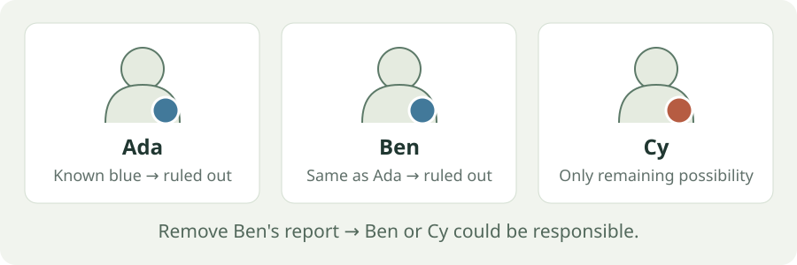

# Test what the evidence actually supports.

Synthetic logic puzzles for studying **reasoning, uncertainty and evidence sharing**. Generate a case, check what can be inferred, and evaluate an agent without confusing a lucky guess with a supported answer.
{.lead}

[Try the offline tutorial](tutorials/first-dataset.md)
[Explore the results](results/index.md)

## From puzzle to score

1. **Build a case.** Choose the useful evidence, irrelevant records and reliability rules.
2. **Certify it.** Check which answers the evidence permits, including each agent's private view.
3. **Evaluate.** Record correctness, evidential support, abstention and protocol failures separately.

Once installed, generation and saved-result replay work **offline, without an API key or paid calls**.

## Choose a starting point

### Make your first dataset

Generate, validate and export a small case in a few steps.

[Start the tutorial →](tutorials/first-dataset.md)

### Read the experiments

See what happened when models received more evidence, less evidence or more output budget.

[Browse measured results →](results/index.md)

### Understand the guarantees

Learn what a certificate establishes and why a correct answer can still lack support.

[How it works →](explanations/pipeline.md)

### Configure a study

Start from a preset, then look up only the settings you need.

[Find a setting →](reference/parameters.md)

## The latest finding

**Extra irrelevant evidence did not consistently improve accuracy.** The earlier pilot's apparent benefit did not repeat in the expanded follow-up.

Lite's primary score stayed at **10/12** between zero and 1,000 extra records. Four worlds stayed unchanged, one improved and one worsened. Flash remained at **12/12** in every condition.

Costs rose roughly **56× for Lite and 77× for Flash** in the four-report setting, without higher endpoint accuracy. The sample is small, and the combined result is exploratory.

[Read the findings, costs and limitations →](results/index.md#what-is-interesting-about-the-follow-up)

## A puzzle you can solve now

Ada, Ben and Cy have red or blue badges. Badge values may repeat.

- The responsible person has a **red** badge.
- Ada's badge is **blue**.
- Ben's badge has the **same value as Ada's**.

**Cy is the only possible responsible person.** Ada and Ben are both ruled out.

Now remove the report about Ben. **Both Ben and Cy become possible.** An agent that guesses Cy may be correct, but its answer is no longer supported by the available evidence.

This is a teaching example, not a model measurement. [See the formal clue rules](reference/predicates.md), or [download a generated public-only case](assets/quickstart-public.jsonl).

!!! note "An early research preview"
    Version **0.5.0rc2** is [available as a prerelease](https://github.com/TrustPrism/clue-benchmark/releases/tag/v0.5.0rc2). Licensing, ownership clearance and independent reviews remain pending. Public availability does not grant a redistribution license. [See the open questions](results/open-questions.md).

Software, schema and historical versions

- **Software:** `0.5.0rc2`.
- **Current dataset schema:** `clue-community-1`.
- **Legacy flat data:** `0.3.0`.

Study IDs, source hashes and presentation IDs serve different purposes. The [data dictionary](reference/data-dictionary.md) explains these identities and the evaluator-only files.

