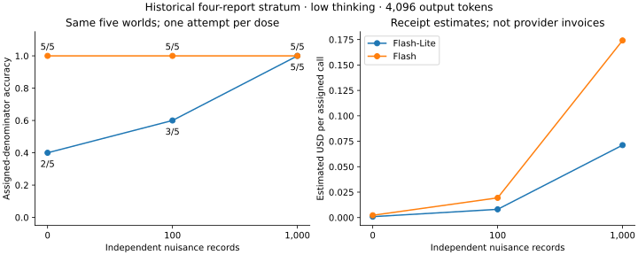

# Preliminary measured results

These are separate historical studies with different thinking budgets, input shapes, adaptive/fresh status and denominators. No pooled leaderboard is supported. Recompute from sanitized per-assignment records without credentials:

```sh
clue-benchmark examples replay measured-results --output runs/measured
```

With the optional figures extra installed, add `--figures` to reproduce the paired accuracy/cost SVG. The command writes `results.json` and an accessible local HTML report with study-specific tables, source hashes and assigned counts.



The same five worlds appear at all doses, with one attempt each. Additional context cost more. This small positive Lite observation is a hypothesis, not a general claim that weaker agents benefit from noise.

## Information availability

Eight worlds: Flash 8/8 complete answers, 32/32 appropriate abstentions on ambiguous private views, and 8/8 answers when one-round star forwarding delivered the needed evidence. Lite made two lucky correct ring guesses with insufficient evidence. Forwarding was programmed. The [offline tutorial](../tutorials/distributed-evidence.md) reproduces solver controls separately from these model counts.

## Nuisance records

Four necessary reports: Lite 2/5, 3/5, 5/5 at 0/100/1000 records; Flash 5/5 at every dose. Eight necessary reports: Lite 5/8, 5/8, 4/8, with a provider error included at the last dose. That last count is not four observed reasoning errors. One repetition; 8/32 preplanned identical-payload pairs elsewhere changed answers, all Lite. [Sanitized assignment records](../assets/pilot.json).

The new preregistered $10 follow-up has only offline preparation, no new measured results, no settled estimate and no unresolved holds. Its preflight selected eight worlds and 96 scored slots, maximum $9.338478 plus the $0.50 probe reserve. Final execution/access/identity authorization is pending. Null or negative results are equally publishable.

## Certified burden

Flash 30/30 in each 32-report path/tree arm; Lite 9/30 and 7/30. These are three attempts on ten worlds per arm. A simple heuristic solves some constructions. Necessary-report cost is not proof depth or model difficulty. High thinking differs from the motivating low-thinking pilot. [Sanitized records](../assets/hardness.json).

## Hard cases and resources

Fresh confirmation: 9/48 correct, 28 wrong, 11 abstentions, no provider/protocol errors, 48 independent worlds, 64 suspects, 455 interacting reports, 32768 output tokens including thinking. The 455 reports were not individually necessary. Estimated $7.231002 belongs to a closed historical allowance. [Fresh records](../assets/flash-hard-scale.json).

An earlier adaptive same-six-world comparison rose from 2/6 to 5/6 with more output allowance. Preserve adaptive status and resource differences. [Adaptive records](../assets/flash-limits.json).

## Completion versus supported correctness

Sampled Qwen: 67/72 valid final actions, 22 supported correct, 15 wrong with sufficient evidence, 11 appropriate abstentions, 19 unsupported answers including two lucky correct guesses, and five output-limit protocol failures. Three receipts were reused; 72 slots were not 72 fresh calls or independent worlds. On 29 matched returned slots completion rose 13/29 to 25/29 while supported correctness changed 13/29 to 12/29. More completed outputs did not imply better reasoning. [Sanitized indexed outcomes](../assets/qwen-sampled-screening.json) permit count replay; full raw provider replay remains private/pending rights and sanitization review.

## Provenance and limits

[Source/checksum/sanitization index](../assets/index.json) records original source paths and SHA-256 values plus hashes of the distribution copies. Only selected evaluator outcome fields are retained; no raw receipt, approval, checkpoint or model prose is shipped. These summaries are evaluator data and must not be placed in agent prompts. Hashes are integrity evidence, not ownership clearance.

The original documents and immutable source/data archives remain preserved in the private repository. Licensing, outside reproduction and human template review remain pending. No inference occurs when reading or replaying these records.
