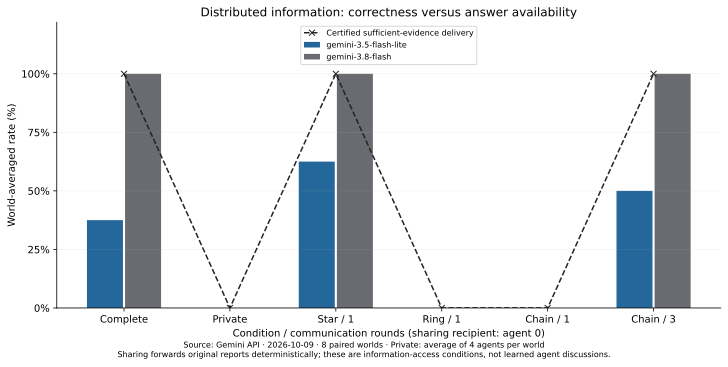
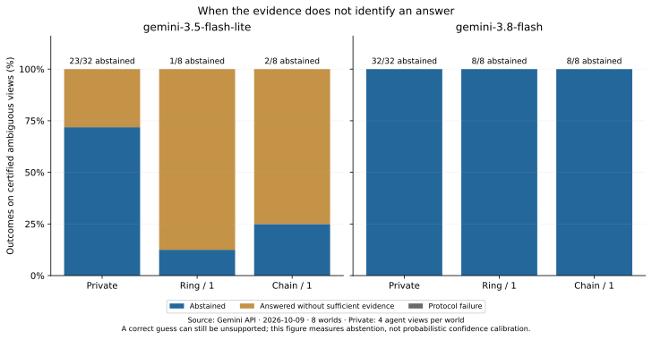
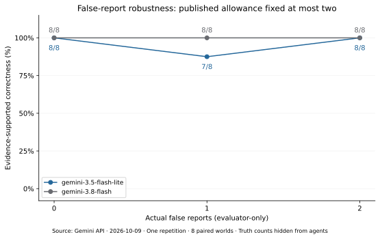
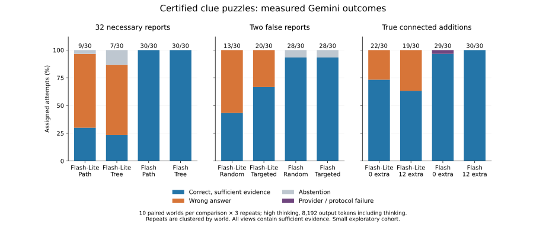
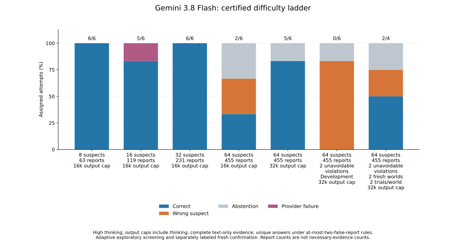
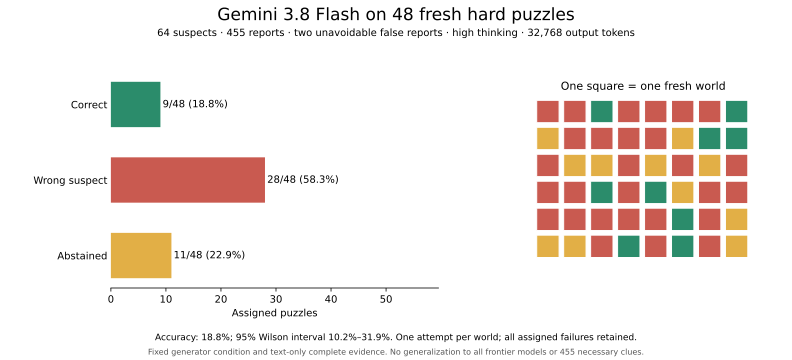
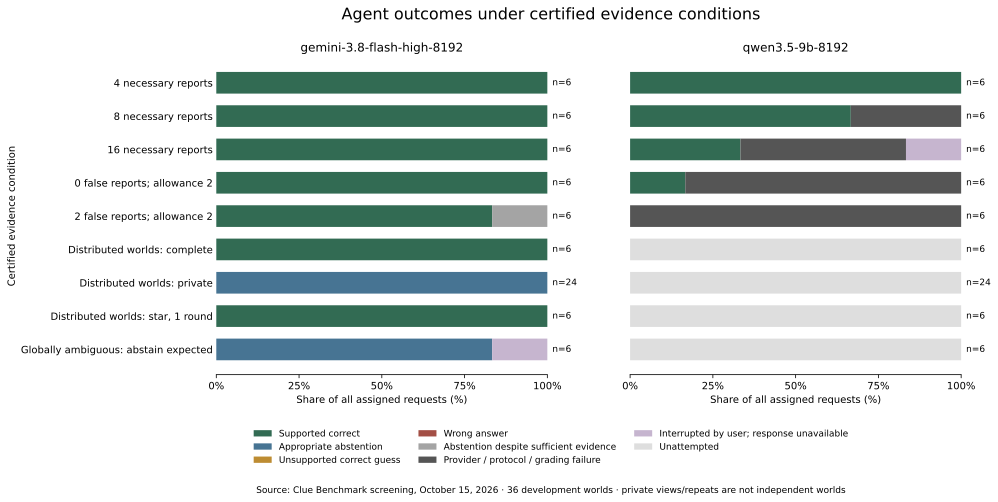

<span id="results-at-a-glance"></span>
<span id="preliminary-measured-results"></span>

# Every experiment, in context

We tested evidence availability, irrelevant volume, false reports, construction shape, useful redundancy, puzzle size, output budgets and model settings. Each comparison tells us something different about reasoning—and about how to measure it.
{.lead}

This page covers **eight model-study families**, including their individual comparisons, plus the offline controls. Each study has the same structure: **what we tested, what happened, what it tells us and what it does not establish**.

Measurements span October 9–27, 2026. This account was expanded on October 28. These are separate small studies, **not a pooled model leaderboard**.
{.figure-note}

## Choose the question you care about

<div class="link-grid study-grid" markdown="1">
<div class="link-card study-card" markdown="1">

<span class="study-meta">01 · Original low-thinking pilot</span>
### What changes when evidence is missing, irrelevant or false?

Correct guesses can lack support; more records and more false reports did not produce a simple difficulty ordering.

[Read the pilot comparisons →](#original-controls)

</div>
<div class="link-card study-card" markdown="1">

<span class="study-meta">02 · High-thinking control study</span>
### Do structure, targeted falsehoods and true extra clues make reasoning harder?

Lite and Flash separated, but the tested controls were not uniformly harder in the intuitively expected direction.

[Read the controlled comparisons →](#high-thinking-controls)

</div>
<div class="link-card study-card" markdown="1">

<span class="study-meta">03 · Flash development stress tests</span>
### When do size and output allowance change the result?

A difficult six-world result improved with more output budget; a stronger construction then exposed new failures.

[Read the scale and budget tests →](#hard-cases-and-resources)

</div>
<div class="link-card study-card" markdown="1">

<span class="study-meta">04 · Fresh hard-set confirmation</span>
### Does difficulty persist on fresh cases?

Flash solved 9/48 fresh, certified cases under the larger allowance, with no provider or protocol failures.

[Read the fresh confirmation →](#fresh-hard-confirmation)

</div>
<div class="link-card study-card" markdown="1">

<span class="study-meta">05 · Initial development screening</span>
### Are failures about reasoning, answer submission or unavailable evidence?

Flash handled easy controls; the original Qwen run exposed output-limit failures and stopped before later assignments.

[Read the initial screening →](#initial-development-screening)

</div>
<div class="link-card study-card" markdown="1">

<span class="study-meta">06 · Three-case Qwen diagnostic</span>
### Can decoding settings repair missing answers?

Sampling improved final-action completion on three cases. A larger allowance did not change those sampled answers.

[Read the settings diagnostic →](#qwen-settings-diagnostic)

</div>
<div class="link-card study-card" markdown="1">

<span class="study-meta">07 · Full sampled-Qwen panel</span>
### Does better completion mean better reasoning?

Completion improved on matched slots, but supported correctness did not. Ambiguous evidence still attracted unsupported answers.

[Read the full development panel →](#completion-versus-supported-correctness)

</div>
<div class="link-card study-card" markdown="1">

<span class="study-meta">08 · Irrelevant-evidence replication</span>
### Does the pilot's apparent noise benefit repeat?

The expanded primary score stayed at 10/12 between endpoint doses, while individual worlds changed and costs rose.

[Read the replication and expansion →](#nuisance-records)

</div>
</div>

## 1. Original pilot: missing evidence, irrelevant records and false reports {#original-controls}

**Setting:** October 9 · Flash-Lite and Flash · low thinking · 4,096 output tokens · structured constraints plus deterministic text. The full pilot had **270 assigned slots across 21 underlying worlds**, 269 settled responses and one provider failure.

### Does delivering the right evidence enable a supported answer? {#information-availability}

**Test.** The same eight puzzles had twelve reports and four agents. Private views were ambiguous; the complete view and some forwarding conditions delivered enough evidence to identify one culprit.

| View at the evaluated receiver | Evidence sufficient? | Flash-Lite | Flash |
|---|---|---|---|
| Complete | Yes | 3/8 correct | 8/8 correct |
| Four private views per world | No | 23/32 abstentions; 9 unsupported wrong answers | 32/32 appropriate abstentions |
| Star, one round | Yes | 5/8 correct; 1 abstention | 8/8 correct |
| Ring, one round | No | 1/8 abstention; 7 unsupported answers, including 2 correct guesses | 8/8 appropriate abstentions |
| Chain, one round | No | 2/8 abstentions; 6 unsupported wrong answers | 8/8 appropriate abstentions |
| Chain, three rounds | Yes | 4/8 correct; 1 abstention | 8/8 correct |

**What it tells us.** Knowing the answer and guessing it are different outcomes. Flash generally matched its behavior to evidence availability; Lite sometimes committed without support. Nine delivered reports could still be insufficient even though an eight-report sufficient subset existed: **which reports arrive matters**.

**Limit.** Forwarding was programmed, not learned. The 32 private views are four views of eight worlds, not 32 independent puzzles. Report order can also change across delivery conditions.

### Does a much larger irrelevant archive change accuracy? {#original-pilot}

**Test.** Add 0, 100 or 1,000 independent nuisance records to the same useful evidence. Necessary-report count stays fixed within each stratum.

| Necessary reports | Model | 0 extra | 100 extra | 1,000 extra |
|---|---|---:|---:|---:|
| 4 | Lite | 2/5 | 3/5 | 5/5 |
| 4 | Flash | 5/5 | 5/5 | 5/5 |
| 8 | Lite | 5/8 | 5/8 | 4/8 assigned |
| 8 | Flash | 8/8 | 8/8 | 8/8 |

The last Lite cell is **4/7 settled successes plus one HTTP 500**, not four observed reasoning errors. The largest observed input was **230,884 tokens**.

**What it tells us.** Volume increased cost much more consistently than it reduced accuracy. The four-report improvement was an interesting hypothesis, not established noise-assisted reasoning; it motivated the [later replication](#nuisance-records).

**Limit.** One attempt per condition, five or eight worlds per stratum, and recognizable independent records rather than realistic adversarial distraction. Comparing the strata also changes suspect count.

### Can models recover an answer when some reports are false? {#pilot-false-reports}

**Test.** Hold the public rule at **at most two false reports**, while adding zero, one or two factual corruptions to matched thirty-report cores. Actual corruptions remain hidden from the agent.

| Actual false reports | Lite correct | Flash correct | Solver assuming all reports true |
|---|---:|---:|---:|
| 0 | 8/8 | 8/8 | 8/8 |
| 1 | 7/8 | 8/8 | 6/8 |
| 2 | 8/8 | 8/8 | 4/8 |

The reliability-aware solver recovered **all 24 answers** across these conditions.

**What it tells us.** The reliability rule is a useful control: treating every report as true can lose recoverable answers. At this size, factual false reports did not reliably defeat either model.

**Limit.** Corruption can change sufficient-evidence cost, so necessary evidence was not held fixed. These small results do not establish a monotonic corruption-difficulty effect.

<details markdown="1">
<summary>Repeatability, original chart and source records</summary>

There were **238 distinct serialized payloads across 270 assignments**. Of 32 preplanned identical-payload pairs, eight changed answers, all for Lite. Its eight-report clean archive baseline scored 5/8 while the identical complete-input distributed baseline scored 3/8. Those changes are response variation, not an information effect.


{ loading=lazy }

{ loading=lazy }

{ loading=lazy }

[All 270 sanitized assignments](../assets/pilot.json) · [Source/checksum index](../assets/index.json).

</details>

## 2. High-thinking controls: structure, corruption and truthful redundancy {#high-thinking-controls}

**Setting:** October 10–11 · Lite and Flash · high thinking · 8,192 output tokens · complete, text-only evidence. **360 assigned requests, 30 underlying worlds, three attempts per variant**, with one retained provider timeout.

### Does the shape of a 32-report proof separate the models? {#certified-burden}

**Test.** Compare paired path and branching-tree constructions with **exactly 32 necessary reports**, six truthful additions and 100 independent records: 138 records in total.

| Structure | Lite correct | Flash correct |
|---|---:|---:|
| Path | 9/30 | 30/30 |
| Branching tree | 7/30 | 30/30 |

**What it tells us.** These cases separated the two models, but the small Lite difference does not establish a reliable path-versus-tree effect. Necessary evidence is an information property, **not a calibrated reasoning-depth score**.

**Limit.** Each denominator thirty is three attempts on ten paired worlds. Some construction families admit simple heuristics; a 32-report certificate does not prove a model followed a 32-step argument.

### Is targeted corruption harder than random corruption? {#targeted-corruption}

**Test.** Eight suspects, seven attributes, 63 reports, exactly two factual corruptions and a public allowance of two. Every complete view uniquely identifies a culprit. Targeted cases retain a wrong explanation one violation beyond the permitted region.

| Corruption policy | Lite correct | Flash correct | Flash's other outcomes |
|---|---:|---:|---|
| Random | 13/30 | 28/30 | 2 abstentions with sufficient evidence |
| Targeted | 20/30 | 28/30 | 2 abstentions with sufficient evidence |

**What it tells us.** The targeted policy did not make Flash perform worse here; Lite performed better on the targeted cases. A logically closer wrong explanation does not automatically translate into greater observed model difficulty.

**Limit.** This compares selection policies. There was **no uncorrupted 63-report model baseline**, so the experiment does not isolate the effect of adding corruption itself. Flash's misses were unnecessary abstentions, not wrong valid answers.

### Do twelve truthful extra comparisons help or distract? {#truthful-additions}

**Test.** Paired near-solution cases with **45 versus 57 reports**. The twelve additions are true, core-entailed comparisons involving the same variables. There are no actual false reports, but the public allowance remains two.

| Condition | Lite correct | Flash correct |
|---|---:|---:|
| Original core | 22/30 | 29/30 assigned; 29/29 returned |
| Twelve truthful comparisons added | 19/30 | 30/30 |

The missing original-core Flash response was the study's provider timeout. It is not a reasoning error.

**What it tells us.** Extra true comparisons are a different intervention from independent noise: they can add useful redundancy and shorten a solution. These results do not support the rule that more reports are always harder.

**Limit.** The small paired differences are descriptive. Outcomes under high thinking and text-only input must stay separate from the earlier low-thinking, structured-input pilot.

<details markdown="1">
<summary>Resource limits, evaluated versus prepared arms, and sources</summary>

All original assignments were dispatched; 359 settled. A separately approved continuation sent only untouched assignments, never retried the timeout. **215 responses used at least 95% of the output cap**, despite no `MAX_TOKENS` endings. `STOP` does not prove the allowance was nonlimiting.

The larger bank contained **19 certified arms, 190 variants and 50 worlds**. Only the six arms above were measured. The relational-32, archive-placement and eight-agent preparations are not additional model results.

{ loading=lazy }

[All 360 sanitized assignments](../assets/hardness.json) · [Source/checksum index](../assets/index.json).

</details>

## 3. Flash stress tests: puzzle size, output budget and unavoidable errors {#hard-cases-and-resources}

**Setting:** October 11 · Flash, high thinking · complete text-only evidence · development screening followed by adaptive comparisons. Across selected conditions: **40 assignments on 32 worlds**, 39 returned responses and one retained provider 503.

### Does increasing puzzle size expose a hard regime? {#size-ladder}

**Test.** Six worlds at each of four sizes, under a 16,384-token output allowance. The public rule permits at most two false reports; two sampled reports are false.

| Suspects | Reports | Correct | Other outcomes |
|---|---:|---:|---|
| 8 | 63 | 6/6 | None |
| 16 | 119 | 5/6 assigned | One provider 503; all five returned answers correct |
| 32 | 231 | 6/6 | None |
| 64 | 455 | 2/6 | 2 wrong suspects, 2 abstentions |

**What it tells us.** The ladder found an observed difficult regime, rather than assuming that every size increase is harder.

**Limit.** Different sizes use different worlds. Factual corruption is not necessarily unavoidable: all six 32-suspect cases admitted an alternative all-true explanation with the same culprit. Report count is not necessary-report count.

### Do the same failures survive a larger output allowance? {#matched-output-budget}

**Test.** Reuse the identical six 64-suspect cases and increase the allowance from 16,384 to 32,768 tokens, including thinking.

| Output allowance | Correct | Wrong suspects | Abstentions |
|---|---:|---:|---:|
| 16,384 | 2/6 | 2 | 2 |
| 32,768 | 5/6 | 0 | 1 |

**What it tells us.** The original 2/6 was resource-sensitive, not a stable failure rate. More output allowance recovered both wrong answers and one abstention.

**Limit.** This was an adaptive demonstration on six existing development worlds. The extra calls do not create six new independent cases or an unlimited-compute result.

### What if a correct explanation must tolerate actual contradictions? {#unavoidable-errors}

**Test.** Construct cases where the correct culprit needs **two unavoidable violations**, while every wrong culprit needs at least three, under allowance two. Use the larger 32,768-token allowance.

| Cohort | Correct | Wrong suspects | Abstentions |
|---|---:|---:|---:|
| Stronger development condition: 6 worlds | 0/6 | 5 | 1 |
| Fresh small confirmation: 2 worlds, 2 attempts each | 2/4 | 1 | 1 |

Each small-confirmation world was solved once and missed once, even at temperature zero.

**What it tells us.** The construction can expose failures after the earlier output-budget recovery. Variation across attempts remains important.

**Limit.** The new worlds also changed other construction properties, including how many wrong suspects were near the allowed region. This does not isolate a causal effect of unavoidable violations alone. The two-world confirmation is not a population failure-rate estimate.

<details markdown="1">
<summary>Grading correction, prepared conditions and source records</summary>

One online grading solve timed out on a correct answer. Offline analysis checked the saved answer against the independently validated unique-answer certificate. The unresolved original grade remains preserved; it was not a model reasoning failure.

Seven selected jobs produced the 40 assigned slots. The twelve-job snapshot also contained unselected preparations, including alternative confirmations and a crowded condition. Those are not measured successes or failures.

{ loading=lazy }

[All 40 sanitized assigned outcomes](../assets/flash-limits.json) · [Source/checksum index](../assets/index.json).

</details>

## 4. Fresh hard-set confirmation: does difficulty persist on new cases? {#fresh-hard-confirmation}

**Setting:** October 11 · Flash, high thinking · 32,768 output tokens · **48 fresh worlds, one attempt each**, selected before model responses and screened against the preceding bank.

**Test.** Freeze the stronger condition from the development work and measure disjoint worlds: 64 suspects, seven ternary attributes and 455 interacting reports, with two unavoidable violations for the correct culprit and at least three for each wrong culprit.

| Outcome | Count |
|---|---:|
| Correct and supported | 9/48 |
| Wrong suspect | 28/48 |
| Abstention despite sufficient evidence | 11/48 |
| Provider or protocol failure | 0/48 |

**What it tells us.** A difficult regime persisted on fresh cases under the stated model, prompt and larger finite allowance. These misses were not explained by missing evidence, transport errors or malformed final actions.

**Limit.** It does not establish a weakness under unlimited compute, tools or other models. Each response used about **31,500 output tokens**, near the allowance, even though all ended with `STOP`. The 455 reports were **not** certified individually necessary; sufficient-evidence bounds were three to 455.

<details markdown="1">
<summary>Uncertainty, resources and sources</summary>

Accuracy was **18.75%**, with a descriptive 95% Wilson interval of **10.2%–31.9%** for this generator condition. All requests had known usage and the expected returned model identity; there were no context overflows, retries or grading timeouts.

{ loading=lazy }

[All 48 sanitized assignments](../assets/flash-hard-scale.json) · [Source/checksum index](../assets/index.json).

The prepared snapshot and measured snapshot are distinct. Earlier instructions to stop before inference belong to the prepared record; later authorization preceded the measured run.

</details>

## 5. Initial development screening: easy controls, abstention and missing actions {#initial-development-screening}

**Setting:** October 15 · 36 development worlds · Flash high thinking and local Qwen3.5 9B, each with an 8,192-token allowance and text-only evidence. Qwen's original decoding used temperature zero.

**Test.** Give each model 72 assigned slots across necessary-evidence, false-report, information-delivery and globally ambiguous controls: **144 total**. The panel measured behavior under available and unavailable evidence, while checking whether native answer actions were submitted at all.

### Flash: were these useful easy and abstention controls?

| Condition | Observed Flash outcome |
|---|---|
| 4, 8 and 16 necessary reports | 6/6 supported correct in each arm |
| No false reports, allowance two | 6/6 supported correct |
| Two false reports, allowance two | 5/6 supported correct; 1 unnecessary abstention |
| Distributed, complete evidence | 6/6 supported correct |
| Distributed, private evidence | 24/24 appropriate abstentions |
| Distributed, one-round star | 6/6 supported correct |
| Globally ambiguous | 5 appropriate abstentions; 1 user-interrupted request with no saved response |

**What it tells us.** The burden arms were easy for Flash under this configuration. The private and globally ambiguous controls again showed that abstention can be the appropriate behavior. Programmed star delivery restored sufficient information.

### Qwen: were missing answers being mistaken for reasoning failures?

| Originally attempted arm | Supported correct | Output-limit protocol failures | Unavailable response |
|---|---:|---:|---:|
| 4 necessary reports | 6 | 0 | 0 |
| 8 necessary reports | 4 | 2 | 0 |
| 16 necessary reports | 2 | 3 | 1 user interruption |
| No false reports, allowance two | 1 | 5 | 0 |
| Two false reports, allowance two | 0 | 6 | 0 |

Qwen returned **29 saved responses: 13 supported correct and 16 protocol failures**. Another request was interrupted. **42 later assignments were unattempted**: the distributed complete/private/star views and globally ambiguous control.

**What it tells us.** Before interpreting reasoning ability, the benchmark must establish that the runtime can reliably submit an answer. This result motivated a separate settings diagnostic.

**Limit.** Unattempted slots are **not observed wrong answers**. The two interrupted requests across providers are unavailable observations, not proven reasoning or protocol failures. Overall there were **100 returned responses**, not 144 completed calls. This was development calibration, not fresh held-out evaluation or equal-compute comparison across providers.

<details markdown="1">
<summary>Assigned outcomes and source records</summary>

{ loading=lazy }

[All 144 sanitized assigned slots and per-condition summaries](../assets/development-screening.json).

</details>

## 6. Qwen settings diagnostic: can decoding repair answer submission? {#qwen-settings-diagnostic}

**Setting:** October 15 · three selected development worlds · one request per configuration/case · **nine local calls**, with no API token charge. Cases covered four necessary reports, sixteen necessary reports and two false reports.

**Test.** Hold the public observations and native tools fixed. Compare thinking disabled at 8K, sampled thinking at 8K, and the same sampled setup at 32K.

| Configuration | Valid final actions | Supported correct | Generated tokens |
|---|---:|---:|---:|
| Thinking disabled, 8,192 output tokens | 2/3 | 1/3 | 13,990 |
| Sampled thinking, 8,192 output tokens | 3/3 | 1/3 | 4,765 |
| Sampled thinking, 32,768 output tokens | 3/3 | 1/3 | 4,765 |

### What happened on each case?

| Case | Thinking disabled, 8K | Sampled thinking, 8K | Sampled thinking, 32K |
|---|---|---|---|
| 4 necessary reports | Wrong answer | Supported correct | Supported correct |
| 16 necessary reports | Supported correct | Wrong answer | Wrong answer |
| Two false reports | Output-limit protocol failure | Wrong answer | Wrong answer |

**What it tells us.** Sampling repaired the missing-final-action symptom on this small diagnostic, while exposing genuine wrong answers. The sampled 8K and 32K runs returned **identical actions and token counts**, all below 8K: a larger allowance provided no benefit on these three cases. Disabling thinking did not consistently improve completion or accuracy.

**Limit.** Three selected cases cannot establish general reliability, identify which sampling parameter caused a change, or rule out budget benefits on other truncations. The later full panel carried forward all three sampled-8K receipts; they are not fresh follow-up calls.

<details markdown="1">
<summary>Exact controls and runtime interpretation</summary>

All three diagnostic configurations used temperature 1, top-p 0.95, top-k 20, min-p 0, presence penalty 1.5, repeat penalty 1 and seed 0. The thinking toggle held these sampling settings constant. The local context was 65,536 tokens; timeouts were 900 seconds at 8K and 1,800 at 32K.

Thinking-disabled receipts confirmed the runtime honored that toggle. The original screening's temperature-zero policy was different. The later sampled comparison therefore does not isolate temperature alone.

Summed provider-reported local times were **484.6, 170.7 and 150.1 seconds**, respectively. Different times with identical sampled token counts do not prove a speed advantage; caching/runtime conditions were uncontrolled. There were no retries, missing responses, provider errors or identity changes.

[All nine sanitized outcomes and recomputed summaries](../assets/qwen-settings-diagnostic.json).

</details>

## 7. Full sampled-Qwen panel: does better completion mean better reasoning? {#completion-versus-supported-correctness}

**Setting:** October 15 · the same 36-world development panel · sampled thinking at 8,192 output tokens · **72 slots: 69 new local calls plus three diagnostic receipts**. No API token charge; local compute still has a resource cost.

**Test.** Complete the development panel under the sampled setup, preserving all settings-pilot outcomes and every failure category.

| Condition | Slots | Observed outcomes |
|---|---:|---|
| 4 necessary reports | 6 | 6 supported correct |
| 8 necessary reports | 6 | 5 supported correct; 1 wrong with sufficient evidence |
| 16 necessary reports | 6 | 3 wrong with sufficient evidence; 3 output-limit failures |
| No false reports, allowance two | 6 | 1 supported correct; 4 wrong; 1 output-limit failure |
| Two false reports, allowance two | 6 | 6 valid wrong answers |
| Distributed, complete evidence | 6 | 5 supported correct; 1 wrong |
| Distributed, private evidence | 24 | 10 appropriate abstentions; 14 unsupported answers, including 1 correct guess |
| Distributed, one-round star | 6 | 5 supported correct; 1 output-limit failure |
| Globally ambiguous | 6 | 1 appropriate abstention; 5 unsupported answers, including 1 correct guess |

Private views are four views of each of six worlds. Their 24 slots are **not 24 independent worlds**. Supported correctness is not possible on a genuinely ambiguous view; appropriate abstention is the relevant successful behavior.

### Did the settings change improve the previously returned slots?

| Outcome on 29 matched returned slots | Original setup | Sampled setup |
|---|---:|---:|
| Valid final action | 13/29 | 25/29 |
| Supported correct | 13/29 | 12/29 |

**What it tells us.** The improved configuration generalized mainly in **completion**, not supported accuracy. The full panel exposed distinct difficulties: no supported answers in the sixteen-report arm, valid but wrong answers in the two-false-report arm, and frequent unsupported commitments when evidence was ambiguous.

Across all 72 slots, there were **22 supported correct, 15 wrong with sufficient evidence, 11 appropriate abstentions, 19 unsupported answers and five output-limit failures**. Two unsupported answers were lucky correct guesses. Native completion was **67/72**.

**Limit.** The matched subset spans 23 worlds and was selected by the original stopping history. Settings and timeout policy changed; this is descriptive, not a causal temperature experiment. These are reused development worlds, not a fresh final benchmark. Better completion does not make Qwen reliable.

<details markdown="1">
<summary>Resource accounting and source records</summary>

The recorded panel used **161,612 input tokens and 140,434 generated tokens**, including reused pilots. Summed provider-reported local duration was **94.7 minutes**; this is not wall time or equal compute with Flash. All five protocol failures hit exactly 8,192 generated tokens.

All slots have known usage, with no unattempted assignments, transport errors or identity mismatches. [All 72 sanitized outcomes](../assets/qwen-sampled-screening.json). The [initial screening](../assets/development-screening.json) and [nine diagnostic outcomes across three cases](../assets/qwen-settings-diagnostic.json) remain separate.

</details>

<span id="what-is-interesting-about-the-follow-up"></span>

## 8. Irrelevant-evidence replication: does the pilot's benefit repeat? {#nuisance-records}

**Setting:** October 27 · Lite and Flash, low thinking · 4,096 output tokens · structured text. Matched 0/100/1,000 irrelevant-record variants, with two separately dispatched attempts per model/dose/world.

**Test.** Revisit the original pilot's apparent Lite improvement on fresh, screened worlds. The primary endpoint is Lite's 1,000-minus-zero accuracy change in the four-necessary-report setting, averaging attempts within each world.

### Initial study and final expansion {#follow-up-and-final-expansion}

The initial phase used **eight worlds**, four per setting: 96 scored calls and two probes. The final expansion used the **four remaining screened worlds**, two per setting: 48 more scored calls.

Every cell below follows **0 → 100 → 1,000 extra records**.

| Phase | Lite: 4 necessary reports | Lite: 8 necessary reports | Flash: both settings |
|---|---|---|---|
| Initial | 7/8 · 5/8 · 7/8 | 6/8 · 3/8 · 4/8 | 8/8 at every dose |
| Expansion | 3/4 · 4/4 · 3/4 | 3/4 · 2/4 · 3/4 | 4/4 at every dose |
| Exploratory combined | 10/12 · 9/12 · 10/12 | 9/12 · 5/12 · 7/12 | 12/12 at every dose |

**What it tells us.** The original improvement did not repeat consistently. In the primary setting, four worlds stayed unchanged, one improved and one worsened: the aggregate endpoint score stayed at **10/12**. The eight-report **9/12 → 5/12 → 7/12** pattern is a possible distraction signal, but small and non-monotonic. Flash stayed at the ceiling in this narrow setting.

The cost increase was clearer: in the four-report setting, mean scored-call costs rose about **56× for Lite and 77× for Flash**, without higher aggregate endpoint accuracy. Mean endpoint costs changed from less than $0.01 to **$0.07** for Lite and less than $0.01 to **$0.17** for Flash.

**Limit.** The combined denominator twelve means two attempts on six worlds, not twelve independent worlds. The primary mean change was zero, with a descriptive 95% world-bootstrap interval of **−25 to +25 percentage points**. Equal observed accuracy is not evidence of equivalence. Expansion came after the initial results, so the combined result is exploratory even though world selection used the remaining pre-screened seed prefix rather than model outcomes.

<details markdown="1">
<summary>Accuracy figures, phase costs and source records</summary>

<picture>
  <source media="(max-width: 600px)" srcset="../assets/nuisance-summary-mobile.svg">
  
</picture>


The initial estimate was **$4.73**, including **$0.24 for probes**; expansion added **$2.23**, for **$6.96 total** against the single **$10.00** cap. The maximum preflight commitment was **$9.40**. All 146 paid requests settled, with no holds or provider/protocol failures. The allowance is closed.

[Phase-separated analysis](../assets/nuisance-extended-results.json) · [All 144 scored assignments](../assets/nuisance-extended-measurements.json) · [Reproduction index](../assets/nuisance-extended-reproduction.json). The original [96-call analysis](../assets/nuisance-followup-results.json) and [initial reproduction index](../assets/nuisance-followup-reproduction.json) remain available.

</details>

## Offline controls: what was validated without model calls? {#offline-controls}

These checks matter to the benchmark's interpretation, but they are **not additional model-performance experiments**.

### Do information-delivery labels agree with the solver?

On the six-world prepared development fixture, the solver found supported answers for **6/6 complete** and **6/6 star** views, and appropriately abstained on **24/24 private views** and **6/6 globally ambiguous views**. The shared control gave **24/24 sufficient private views**.

All capacity-two chain conditions remained insufficient, including the receiver-aware three-round variant. A delivery bottleneck must not be reported as a model reasoning failure.

### Can a simple strategy solve high-burden constructions?

A solver-free equality-propagation heuristic solved **6/6 in each of nine prepared burden arms**: branching, branching with 100 irrelevant records, and equality-tree constructions at burdens 4, 8 and 16.

**What it tells us.** A necessary-report certificate can coexist with a simple construction-specific strategy. The heuristic reads public structured constraints, so it is a construction diagnostic—not a matched text-only model comparison. It is deliberately incomplete elsewhere and abstains under allowance two, even when no report is actually false.

### Do presentation changes preserve the formal puzzle?

Renaming, reversing report order and switching to the expanded investigation template preserved sampled worlds and core report identities on one case per prepared arm.

**What it tells us.** These are formal invariance checks. They are not independent human judgments that every English wording is equivalent.

### Which preparations should not be mistaken for measured results?

| Preparation | What exists | What was not established |
|---|---|---|
| Advanced hardness bank | 19 arms, 190 variants, 50 worlds; six arms selected for model evaluation | Scores for the other prepared arms, archive-placement or eight-agent conditions |
| Flash stress bank | Twelve frozen jobs; seven selected jobs produced the 40 assigned slots | Outcomes for unselected crowded/alternative confirmation conditions |
| Publication reference suite | 42 worlds, 96 variants, 16 bundles; six transfer worlds excluded from development model plans | A completed broader model panel or measured transfer performance |
| Large-corpus profile/preset | An offline 50,000-total-record scaling control | 50,000 necessary clues, a measured model score, or a universal throughput claim |
| Independent-reader packet | 18 blinded views, covering ten core predicate types plus independent records | Completed human review or outside reproduction |

The broader 486-request calibration design, additional model families and proposed fresh final study are **plans, not completed evaluations**. Automated agreement also does not remove shared CP-SAT infrastructure from the two main solver encodings.

[Sanitized solver/heuristic controls and preparation counts](../assets/offline-controls.json).

## Sources, downloads and offline replay {#where-to-find-the-original-results}

Every family is retained. These files contain **evaluator outcomes**, not agent input material.

| Study family | Saved evidence |
|---|---|
| Original pilot: information, volume and false reports | [270 assignments](../assets/pilot.json) |
| High-thinking structure/corruption/redundancy controls | [360 assignments](../assets/hardness.json) |
| Flash size/budget/unavoidable-error development | [40 assignments](../assets/flash-limits.json) |
| Fresh hard-set confirmation | [48 assignments](../assets/flash-hard-scale.json) |
| Original development screening | [144 assigned slots, including interruptions and unattempted work](../assets/development-screening.json) |
| Qwen settings diagnostic | [Nine saved outcomes](../assets/qwen-settings-diagnostic.json) |
| Full sampled-Qwen panel | [72 slots, with reuse labeled](../assets/qwen-sampled-screening.json) |
| Irrelevant-evidence replication and expansion | [144 scored assignments](../assets/nuisance-extended-measurements.json) · [Phase analyses](../assets/nuisance-extended-results.json) |
| Offline validation and construction controls | [Solver, heuristic and preparation summaries](../assets/offline-controls.json) |

The [complete experiment source index](../assets/experiment-source-index.json) records the coverage and download hashes. The [historical sanitization index](../assets/index.json) and [nuisance reproduction index](../assets/nuisance-extended-reproduction.json) preserve earlier source identities. Newly published development summaries use a positive field allowlist: no observations, provider prose, receipts, credentials, authorizations or ledgers.

Replay the studies already packaged with the installed candidate:

```sh
clue-benchmark examples replay measured-results \
  --output runs/measured
```

Or replay the phase-separated nuisance study:

```sh
clue-benchmark examples replay nuisance-followup \
  --output runs/nuisance
```

Open the output directory's **`report/index.html`**. These commands make no model calls. Add `--figures` with the optional figures extra.

The newly linked **original development screening, Qwen settings diagnostic and offline-control summaries are documentation downloads**; they are not retroactively added to the published wheel's installed replay. Their summary counts were recomputed from the saved records.

From a checkout of the current documentation source, validate the expanded catalog using only its public files:

```sh
python examples/validate_experiment_sources.py
```

This checks download hashes, all eight families' assigned-slot/world counts and key outcome totals. It makes no model calls and needs no private run directories.

<details markdown="1">
<summary>Historical costs and unresolved reservations, kept separate</summary>

| Study record | Settled estimate | Recorded unknown-usage hold |
|---|---:|---:|
| Original pilot | $4.01 | $0.17 |
| High-thinking controls | $9.68 | $0.04 |
| Flash development stress tests | $3.87 | $0.08 |
| Fresh 48-world confirmation | $7.23 | $0.00 |
| Initial development screening | $1.01 | $0.03 |
| Qwen settings diagnostic | $0.00 API charge | $0.00 |
| Full sampled-Qwen panel | $0.00 API charge | $0.00 |
| October 27 nuisance replication plus probes | $6.96 | $0.00 |

These records use **separate or nested historical allowances**, not one new combined budget. The original pilot and high-thinking study shared a $20.00 parent ceiling; the later studies had their own declared allowances. Holds remain part of the historical record; missing usage is not assumed free. Values are rounded to two decimals here, while integer-microdollar records remain exact. Local compute is not costless just because its API charge is zero. None of these closed runs authorizes further calls.

</details>

## What the experiments collectively establish—and leave open {#provenance-and-limits}

The evidence supports a useful diagnostic resource with **easy controls, difficult regimes and distinguishable failure modes**.

- **Information matters:** accuracy can hide unsupported guessing; abstention can be correct behavior.
- **A control is not a universal difficulty slider:** more false reports, more necessary reports or more text need not lower every model's score.
- **Resources matter:** output budgets and decoding can change completion and correctness in different ways.
- **Construction matters:** certified information requirements do not prove cognitive depth or exclude shortcuts.
- **Replication matters:** a surprising small-sample benefit can weaken on fresh worlds.

Keep the limits equally visible:

- Repeated attempts, private views, matched variants and reused receipts are not new independent worlds.
- Thinking settings, text-only versus structured inputs, output limits, development selection and fresh confirmation differ across studies.
- Supported correctness certifies available evidence, **not a verified reasoning trace**.
- Small cohorts and descriptive intervals do not establish a universal model ranking or a general reasoning scale.
- Human template review, outside reproduction and full licensing clearance remain pending.

Original measured records and frozen sources are preserved. The existing repository/history is public at the owner's request; ignored operational archives remain local. No new model calls were made to expand this page.

[Read the unanswered research and release questions →](open-questions.md)
