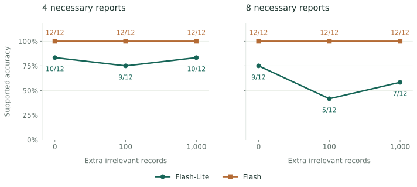
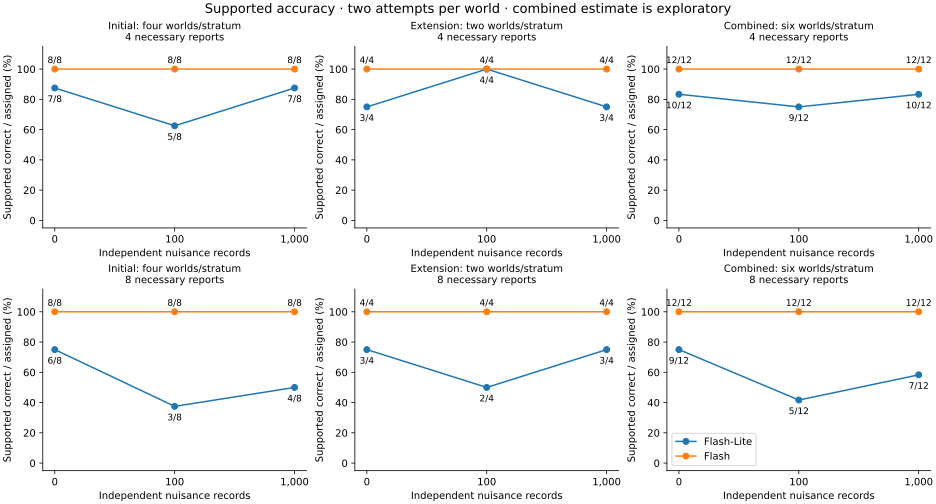
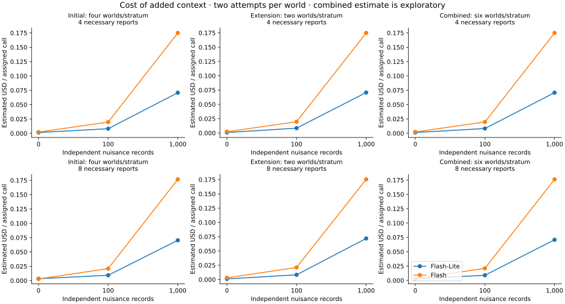

# Results at a glance

The surprising pilot result did not repeat consistently: extra irrelevant evidence cost much more, without a reliable accuracy benefit in the follow-up.
{.lead}

<div class="metric-grid" markdown="1">
<div class="metric" markdown="1">

<span class="metric-label">Scored responses</span>
**144**
<span>Plus two compatibility probes.</span>

</div>
<div class="metric" markdown="1">

<span class="metric-label">Underlying worlds</span>
**12**
<span>Six per evidence-burden setting.</span>

</div>
<div class="metric" markdown="1">

<span class="metric-label">Estimated total</span>
**$6.96**
<span>Under the single $10.00 cap.</span>

</div>
</div>

[Jump to original studies and downloads](#where-to-find-the-original-results) · [Read the open questions](open-questions.md)

## What we learned {#what-is-interesting-about-the-follow-up}

### The earlier improvement was fragile

In the original pilot, Lite improved from **2/5 to 5/5** between zero and 1,000 irrelevant records. In the expanded follow-up's four-report setting, it scored **10/12 at both endpoints**.

### An unchanged average hid individual changes

Four primary worlds stayed unchanged. One improved and one worsened. Extra evidence sometimes changed performance, but without a consistent direction.

### The harder setting may reveal distraction

With eight necessary reports, Lite scored **9/12 → 5/12 → 7/12** as irrelevant records increased. That dip and partial recovery are suggestive, but the pattern is too small and irregular to establish a dose-response effect.

### The cost increase was clearer than the accuracy effect

In the four-report setting, adding 1,000 records increased average call cost about **56× for Lite and 77× for Flash**. Aggregate endpoint accuracy did not improve. Flash stayed at **12/12 throughout** in both settings.

!!! note "How much can we conclude?"
    Only **six worlds** underpin each setting. Two attempts per world do not make twelve independent cases. The combined result is **exploratory** because the expansion came after the initial results. An unchanged score does not prove that extra evidence has no effect.

## Irrelevant evidence: the full comparison {#nuisance-records}

Each column below adds independent, logically irrelevant records to otherwise matched puzzles. Useful evidence and model settings stay fixed across the doses.

<picture>
  <source media="(max-width: 600px)" srcset="../assets/nuisance-summary-mobile.svg">
  
</picture>

Two attempts on six worlds per setting. Counts are responses, not twelve independent worlds. The initial and extension phases are also reported separately below.
{.figure-note}

| Model | Necessary reports | 0 extra | 100 extra | 1,000 extra |
|---|---:|---:|---:|---:|
| Lite | 4 | **10/12** | 9/12 | **10/12** |
| Lite | 8 | **9/12** | 5/12 | 7/12 |
| Flash | 4 | 12/12 | 12/12 | 12/12 |
| Flash | 8 | 12/12 | 12/12 | 12/12 |

Flash's ceiling performance applies to these cases and settings. It is not a general robustness claim.

### Initial follow-up and final expansion {#follow-up-and-final-expansion}

The **initial study** used eight worlds, four per setting: 96 scored calls and two probes.

The **final expansion** used the four remaining worlds from the original screened seed prefix, two per setting: 48 more scored calls. World selection did not use model outcomes, but the decision to expand came after the initial results.

<details markdown="1">
<summary>See the separate phase counts and accuracy chart</summary>

Counts below follow the order **0 / 100 / 1,000 extra records**.

| Phase | Lite: 4 necessary reports | Lite: 8 necessary reports | Flash: each setting |
|---|---|---|---|
| Initial follow-up | 7/8 · 5/8 · 7/8 | 6/8 · 3/8 · 4/8 | 8/8 at every dose |
| Final expansion | 3/4 · 4/4 · 3/4 | 3/4 · 2/4 · 3/4 | 4/4 at every dose |
| Exploratory combined | 10/12 · 9/12 · 10/12 | 9/12 · 5/12 · 7/12 | 12/12 at every dose |



The primary contrast averages the two attempts within each world before comparing 1,000 records with zero. Four primary worlds have no change, one gains 0.5 and one loses 0.5. The mean change is **zero**, with a descriptive 95% world-bootstrap interval of **−25 to +25 percentage points**. The exact two-sided sign-flip p-value is 1.0.

</details>

### What did it cost?

| Part | Estimated spend |
|---|---:|
| Initial follow-up, including probes | $4.73 |
| Final expansion | $2.23 |
| **Combined** | **$6.96** |
| Approved cap | $10.00 |

The initial total includes **$0.24 for two probes**. Every request is settled, there are no unresolved holds, and there were no transport or protocol failures. These are receipt-based estimates, not a provider invoice. The preflight maximum commitment was **$9.40**.

In the four-report setting, mean cost per scored call rose:

- **Lite:** from less than $0.01 to **$0.07**.
- **Flash:** from less than $0.01 to **$0.17**.

Displayed dollar amounts are rounded to two decimals. The downloaded records retain exact accounting. **This allowance is closed; no further paid calls are planned.**

<details markdown="1">
<summary>See costs across every phase and setting</summary>



Panel costs exclude probes. The combined accounting above includes them.

</details>

### Replay these findings offline

```sh
clue-benchmark examples replay nuisance-followup \
  --output runs/nuisance
```

Open **`runs/nuisance/report/index.html`**. The output includes separate initial, extension and combined analyses. It uses saved measurements and makes no model calls.

Add `--figures` if the optional figures extra is installed. [Download the combined analysis](../assets/nuisance-extended-results.json), [all 144 sanitized assignments](../assets/nuisance-extended-measurements.json), or the [reproduction checksum index](../assets/nuisance-extended-reproduction.json).

### The original pilot {#original-pilot}

This is the earlier observation that motivated the follow-up. The same five four-report worlds appeared at every dose, with **one attempt each**.

- **Four necessary reports:** Lite **2/5 → 3/5 → 5/5**; Flash 5/5 throughout.
- **Eight necessary reports:** Lite **5/8 → 5/8 → 4/8**. The final count includes one provider failure; it is not four observed reasoning errors.
- Elsewhere in the pilot, **8/32 preplanned identical-payload pairs changed answers**, all for Lite.


A small positive observation can motivate a study without establishing that noise helps reasoning. [Saved pilot assignments](../assets/pilot.json).
{.figure-note}

## Can the agent know the answer? {#information-availability}

The distributed-evidence pilot used eight worlds. Historical Flash results were:

- **8/8 correct** with complete evidence.
- **32/32 appropriate abstentions** on ambiguous private views.
- **8/8 correct** at the star hub after one round of programmed forwarding.

Lite made **two lucky correct guesses** in ambiguous ring views. Those answers lacked sufficient evidence.

Forwarding was programmed, not learned. The [offline evidence-sharing tutorial](../tutorials/distributed-evidence.md) recomputes the solver controls separately from the saved model counts.

## Does more necessary evidence mean harder reasoning? {#certified-burden}

Not automatically. At 32 necessary reports:

- **Flash:** 30/30 in each path/tree arm.
- **Lite:** 9/30 in one arm and 7/30 in the other.

These are **three attempts on ten worlds per arm**, not thirty independent worlds. The study used high thinking, unlike the low-thinking nuisance pilot. Simple construction heuristics solve some families, so certified evidence cost is not a proof-depth or difficulty scale.

[Saved evidence-burden assignments](../assets/hardness.json).

## Hard cases and output budgets {#hard-cases-and-resources}

A fresh confirmation found a harder regime for Flash:

<div class="metric-grid" markdown="1">
<div class="metric" markdown="1">

<span class="metric-label">Correct</span>
**9/48**
<span>Fresh independent worlds.</span>

</div>
<div class="metric" markdown="1">

<span class="metric-label">Wrong</span>
**28/48**
<span>Observed reasoning errors.</span>

</div>
<div class="metric" markdown="1">

<span class="metric-label">Abstained</span>
**11/48**
<span>No provider/protocol failures.</span>

</div>
</div>

Each case had **64 suspects and 455 interacting reports**, with a 32,768-token output allowance including thinking. The reports were **not** certified individually necessary. The estimated **$7.23** spend belongs to a separate, closed historical allowance.

An earlier **adaptive comparison on the same six worlds** improved from **2/6 to 5/6** with more output allowance. That demonstration and the fresh 48-world confirmation answer different questions; they must not be pooled.

[Fresh confirmation records](../assets/flash-hard-scale.json) · [Adaptive budget comparison](../assets/flash-limits.json).

## More completed answers did not mean better reasoning {#completion-versus-supported-correctness}

In the sampled Qwen screening, **67/72 slots produced a valid final action**. Those 67 outcomes comprised:

- **22** supported correct answers.
- **15** wrong answers despite sufficient evidence.
- **11** appropriate abstentions.
- **19** unsupported answers, including two lucky correct guesses.

The other **five** were output-limit protocol failures. Three responses were reused from the pilot, so 72 slots does not mean 72 fresh calls or independent worlds.

On 29 matched returned slots, completion rose from **13/29 to 25/29**, while supported correctness changed from **13/29 to 12/29**.

**Completion and reasoning quality need separate measures.** [Saved screening outcomes](../assets/qwen-sampled-screening.json). Raw provider replay remains private pending review.

## Original studies and downloads {#where-to-find-the-original-results}

The earlier results have not been replaced by the follow-up. These downloads are **evaluator outcomes**, not agent inputs.

| Study | Saved evidence |
|---|---|
| Original nuisance and distributed-evidence pilot | [Pilot assignments](../assets/pilot.json) |
| Certified evidence burden | [Hardness assignments](../assets/hardness.json) |
| Fresh hard-case confirmation | [48-world assignments](../assets/flash-hard-scale.json) |
| Adaptive output-budget comparison | [Resource comparison](../assets/flash-limits.json) |
| Qwen screening | [Screening outcomes](../assets/qwen-sampled-screening.json) |
| Initial October 27 follow-up | [96-call analysis](../assets/nuisance-followup-results.json) · [Reproduction index](../assets/nuisance-followup-reproduction.json) |
| Final expansion and combined result | [Phase analyses](../assets/nuisance-extended-results.json) · [144 assignments](../assets/nuisance-extended-measurements.json) · [Reproduction index](../assets/nuisance-extended-reproduction.json) |

Recompute all packaged historical panels:

```sh
clue-benchmark examples replay measured-results \
  --output runs/measured
```

Open **`runs/measured/report/index.html`**. Add `--figures` with the optional figures extra to reproduce the historical paired accuracy/cost chart.

## Sources and limits {#provenance-and-limits}

The [source and sanitization index](../assets/index.json) records original source locations, hashes and distribution-copy hashes. The new follow-up has its own [source/archive index](../assets/nuisance-extended-reproduction.json).

Keep these distinctions in mind:

- **Responses are not independent worlds.** Repeats and paired conditions share cases.
- **Settings differ across studies.** Thinking budgets, formats and adaptive/fresh status affect interpretation.
- **Null and failed outcomes remain visible.** No pooled model leaderboard is supported.
- **Integrity is not ownership clearance.** Licensing, outside reproduction and human template reviews remain pending.

Original documents and frozen sources are preserved. The existing repository and its history are public at the owner's request; ignored operational archives remain local. Credentials, authorizations and dispatch ledgers are not part of the documentation deployment. Reading or replaying these records makes no model calls.
